# Sezioni

Ogni trave del modello ha una **sezione composta con il contorno reale**: le
lamiere e gli irrigidimenti sono poligoni (foglio `SectionPart` del file Excel di
feagent), così la vista estrusa mostra la sezione vera e le proprietà vengono
dalla geometria.

## Cassone stradale: dalla tavola PS0093

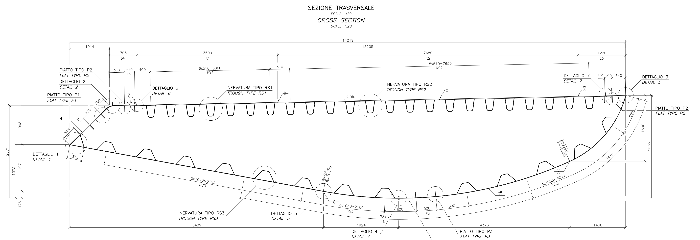
*Fonte: PS0093, Progetto Definitivo 2011, estratto della sezione trasversale.*

La sezione è costruita **dalle quote della tavola, senza tarature**
(`road_section` in `messina_sections.py`). Coordinate in mm, x dalla punta del
naso, z dal punto più basso:

| Elemento | Geometria |
|---|---|
| Ingombro | 14 219 × 2635 mm (D-1: 14,219 × 2,634 m) |
| Naso (lato esterno) | lamiera inclinata t4 dalla punta (0, 1373) allo spigolo (1014, 2371), lamiera di chiusura della punta a 375 mm |
| Piastra superiore | pendenza 2 %, più alta sul bordo interno (14 219, 2635): t4 per 705 mm, t1 corsia di emergenza 3600, t2 corsie di marcia 7680, t3 interna 1220 |
| Fondo (t5) | retta dalla punta a (6489, 176), arco R 10 605 con il punto più basso in x = 8413 (sviluppo 1924, freccia 176), arco fino a x = 12 789, arco R 2581 fino allo spigolo interno |
| Trapezi superiori | 23 a passo 510 dal primo in x = 2072: RS1 (7) e RS2 (16), 230 alla lamiera, 130 al fondo, alti 317 |
| Trapezi del fondo | 13 RS3, 500 alla lamiera, 170 in cima, alti 240 |
| Piatti | P1 152 × 14 sul naso, P2 174 × 16 sulla piastra, P3 140 × 14 sul fondo |

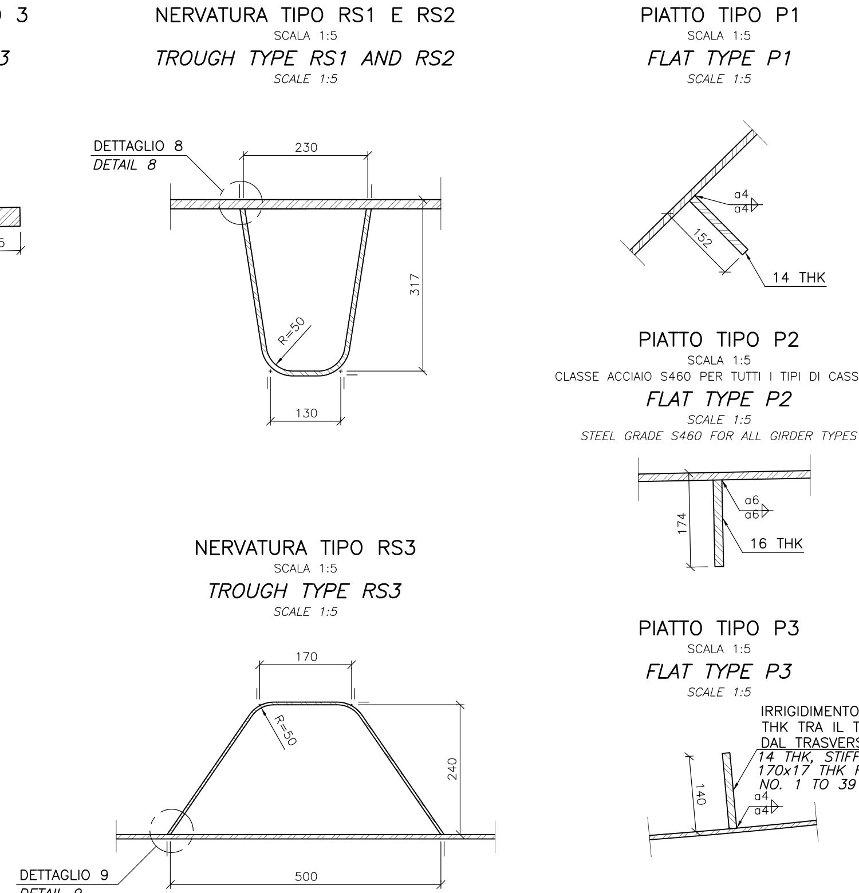
*Fonte: PS0093.*

**Il naso sta sul lato esterno**, verso i pendini: accanto c'è la lamiera della
corsia di emergenza. Il bordo arrotondato è verso la fessura con il cassone
ferroviario.

### Spessori per tipo di concio [mm]

| | CS1 | CS2 | CS3 | CS4 | CS5 | CS6 | CS7 | CS8 |
|---|---|---|---|---|---|---|---|---|
| t1 corsia di emergenza | 14 | 14 | 14 | 14 | 14 | 14 | 14 | 14 |
| t2 corsie di marcia | 17 | 17 | 17 | 17 | 17 | 17 | 17 | 17 |
| t3 lamiera interna | 14 | 14 | 14 | 14 | 14 | 14 | 14 | 14 |
| t4 bordo e naso | 12 | 12 | 12 | 12 | 15 | 12 | 12 | 12 |
| t5 fondo | 8 | 9 | 9 | 12 | 14 | 10 | 13 | 12 |
| RS1 | 7 | 7 | 7 | 7 | 9 | 7 | 7 | 7 |
| RS2 | 9 | 9 | 9 | 9 | 9 | 9 | 9 | 9 |
| RS3 | 5 | 5 | 5 | 6 | 8 | 6 | 6 | 6 |
| acciaio | S355 | S420 | S460 | S460 | S460 | S460 | S460 | S460 |

Fonti: PS0093 (CS1, CS2, CS3, CS6, CS8), PS0097 (CS4, CS5), PS0100 (CS7). Il
tipo di concio di ogni trave si riconosce dalla g di D-1 meno la pavimentazione
(11,95 kN/m), confrontata con i pesi di PS0002 tab. 3.1.

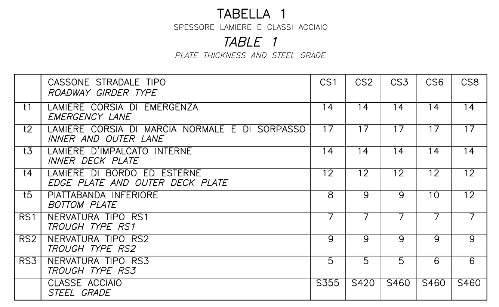

### Confronto con D-1 di IBDAS

| Tipo | A | Iy (verticale) | Iz (laterale) | Iyz [m⁴] | baricentro |
|---|---|---|---|---|---|
| CS1 | +1,2 % | +0,8 % | +1,9 % | +0,216 / +0,214 | 1 cm |
| CS2, CS3 | +1,2 % | +0,7 % | +1,8 % | +0,219 / +0,217 | 1 cm |
| CS4 | +1,2 % | +0,6 % | +2,5 % | +0,230 / +0,214 | 1 cm |
| CS5 | +5,2 % | +2,9 % | +8,4 % | +0,205 / +0,219 | 12 cm |
| CS6 | +1,0 % | +0,4 % | +1,7 % | +0,224 / +0,220 | 1 cm |
| CS7 | +1,2 % | +0,7 % | +2,5 % | +0,233 / +0,217 | 1 cm |
| CS8 | +0,9 % | +0,4 % | +1,7 % | +0,230 / +0,226 | 1 cm |

La sezione presa solo dalla tavola riproduce D-1 entro l'1-2 %. Il piccolo
eccesso viene dai raccordi non modellati. Due eccezioni:

* **CS5**: la tavola ha lamiere più spesse di quelle usate in IBDAS 3.3f
  (area +5 %); vale la tavola;
* **diaframmi longitudinali** di CS4, CS5 e CS7 (due pareti verticali da 16 mm,
  PS0097 e PS0100): sono locali, vicino a giunti e appoggi, e D-1 non li conta
  (con loro l'area sarebbe +10 %). Non si modellano.

Il contorno coincide con quello del **modello a gusci IBDAS** (diaframmi della
fila 3, PS0003 Appendice A):

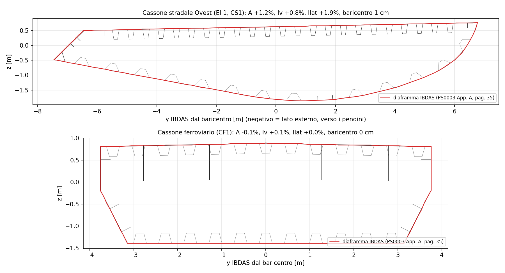

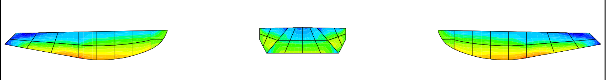
*Fonte: PS0003, Appendice A (uscita IBDAS, vista ortogonale): i nasi stanno ai due bordi esterni.*

{: .warning }
Le figure in prospettiva di PS0002 (fig. 2.3) e PS0003 (fig. 2.6) **non dicono da
che parte stia il naso**: una prima lettura lo metteva verso la fessura. Le
quote della tavola e il diaframma IBDAS lo mettono sul lato esterno, e solo così
il prodotto d'inerzia e il baricentro tornano con D-1.

### Costante di torsione

La costante di Saint-Venant di D-1 (Iv) è quella di **Bredt della sola cella
principale**: con la sezione della tavola la cella principale dà 0,9445 m⁴
contro 0,945 (CS1), 1,0191 contro 1,020 (CS2), 1,2103 contro 1,211 (CS8).
IBDAS trascura le celle chiuse dei trapezi, come si fa di solito per la torsione
globale dei cassoni; la teoria completa delle pareti sottili, che le include,
darebbe circa il 6-7 % in più. Nel modello si usa Iv di D-1.

### Sezione a lamiere e aree efficaci

Il cassone stradale è costruito con il modulo `feagent.lamiere`
([sezioni a lamiere con irrigidimenti](https://github.com/DomenicoGaudioso/feagent)),
lamiera per lamiera come in officina:

| Lamiera | Bordi | Irrigidimenti |
|---|---|---|
| piastra superiore, spessore a tratti t4, t1, t2, t3 | spigolo del naso e spigolo interno | 23 canalette RS1/RS2 (230/130/317 mm) e 4 piatti P2 174 × 16 |
| naso (t4) | punta e spigolo superiore | 2 piatti P1 152 × 14 |
| fondo (t5), retta e due archi | punta e spigolo interno | 13 canalette RS3 (500/170/240 mm) e 2 piatti P3 140 × 14 |
| chiusura della punta (t4) | naso e fondo | nessuno |

Le lamiere sono sulle loro linee medie; le proprietà lorde coincidono con il disegno
della tavola entro lo 0,2-1 % e con D-1 come prima (area +1,2 %, inerzie +1,0 e
+2,1 %). Diaframmi trasversali ogni 3,75 m e acciaio S420 (PS0076).

Il modulo calcola la **sezione efficace** di EN 1993-1-5 per qualsiasi stato di
sollecitazione: sottopannelli fra le canalette (4.4), pannelli irrigiditi come piastra
ortotropa (appendice A.1, come il foglio di verifica di IBDAS descritto in PS0076) e
come colonna (4.5.3), interpolazione (4.5.4), shear lag. È la base per le verifiche
dei cassoni con le combinazioni del modello.

## Cassone ferroviario

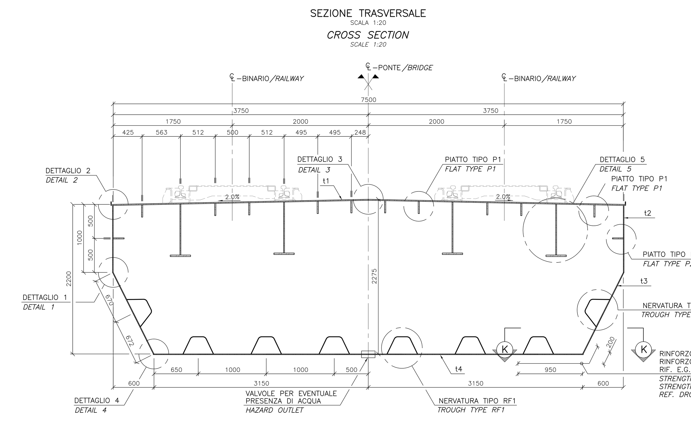
*Fonte: PS0102.*

Costruito dalla tavola come sezione a lamiere (`scripts/messina_lamiere_ferroviario.py`):

* 7500 mm fra le facce interne delle anime, piastra superiore con il colmo al 2 %
  (2275 mm in asse, 2200 ai bordi), anime verticali per 1000 mm con un piatto
  P2 160 × 16, poi inclinate (600 in orizzontale, 1200 in verticale) con una
  canaletta;
* fondo largo 6300 mm con sei canalette RF1 (440/200/250) a ±500, ±1500, ±2500;
* sotto la piastra quattro travi a T (anima 750 × 14, piattabanda 300 × 22) a
  ±1238 e ±2762 mm e piatti P1 180 × 18;
* spessori per tipo di concio (PS0102 tab. 1 per CF1-CF2, relazione PS0077
  tab. 4-2 per gli altri):

| Tipo | Piastra / anima verticale / anima inclinata / fondo / canalette [mm] | Acciaio |
|---|---|---|
| CF1 | 15 / 10 / 10 / 10 / 6 | S355 |
| CF2 | 15 / 10 / 10 / 10 / 6 | S420 |
| CF3 | 15 / 10 / 10 / 30 / 6 | S460 |
| CF4 | 48 / 50 / 50 / 50 / 8, piatti P3/P4 200 × 20 e P5 240 × 24 | S460 |
| CF5 | 15 / 10 / 10 / 14 / 6 | S460 |
| CF6 | 15 / 10 / 10 / 20 / 6 | S460 |
| CF7 | 18 / 20 / 20 / 35 / 6 | S460 |
| CF8 | 15 / 20 / 12 / 25 / 6 | S460 |

Confronto con D-1 (scarti percentuali):

| s [m] | Tipo | A | I verticale | I orizzontale | J |
|---|---|---|---|---|---|
| 300 | CF1 | +1,0 | +0,7 | +1,6 | −0,1 |
| 1505 | CF5 | −0,2 | +1,0 | +0,3 | +2,5 |
| 1589 | CF3 | −0,1 | +1,1 | +0,2 | +2,0 |
| 1618 | CF4 | +3,5 | +3,2 | +6,0 | +3,5 |
| 1739 | CF6 | −0,2 | +1,1 | +0,3 | +2,2 |
| 1768 | CF7 | +0,3 | +1,3 | +1,4 | +2,3 |

Il CF1 ha in più lo sbalzo della piastra e i cordoli, che D-1 non conta. I tipi
CF3-CF7 sono in D-1 circa 0,5 m più alti del CF1 (CF4: 0,725 m), ma nessuna tavola
li disegna: l'altezza in più è nelle anime verticali, che tengono il baricentro entro
1 cm da D-1. La posizione dei piatti del CF4 non è disegnata (anche la relazione e
D-1 non concordano fra loro su quel concio).

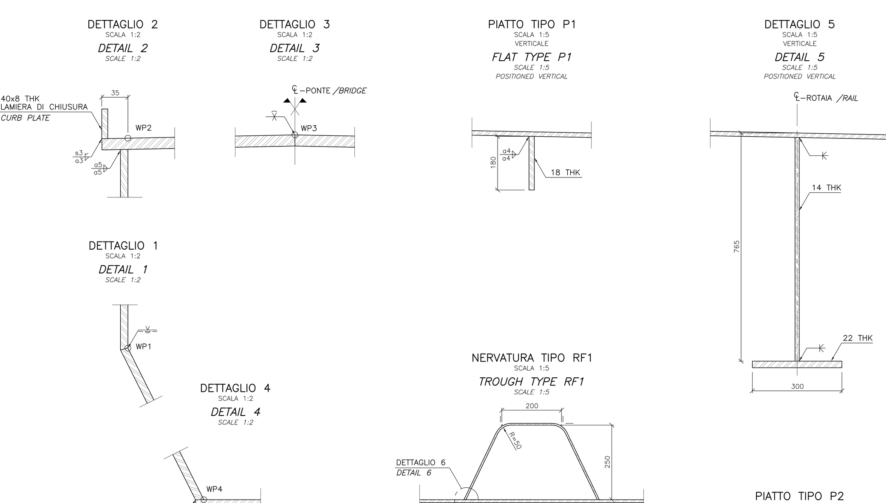

## Traversi dei pendini

Costruiti dalle tavole (`scripts/messina_lamiere_traversi.py`): cassone chiuso con
le anime a 3774 mm (T1, T3) o 6060 mm (T4a, T4b, T6), piastra superiore al 2 %,
piattabanda inferiore orizzontale fino a 8,75 m dall'asse e poi in salita fino al
pendino (T1, T3, T6), a tutta altezza fino a 21,73 m (T4b) o fino al pendino (T4a);
spessori dalla tabella 1 di PS0115, PS0121, PS0122, PS0128; irrigidimenti delle anime
a piatto (T1, T3) o a T (T4, T6), irrigidimenti delle piattabande. Le dimensioni degli
irrigidimenti a T delle piattabande non sono quotate in queste tavole (sono nel
disegno dei diaframmi, non disponibile): sono un'ipotesi dichiarata.

Confronto del T1 di campata con D-1 (scarti percentuali):

| y [m] | A | I verticale | I orizzontale | J |
|---|---|---|---|---|
| ±23,6 | −0,9 | −1,2 | +47 | +13 |
| ±13,2 | +1,9 | −0,8 | +26 | +19 |
| ±8,7 | +9,2 | +4,7 | +18 | +23 |
| ±0,8 | +4,8 | +11 | +8,6 | +5,4 |

L'inerzia orizzontale più grande viene dagli sbalzi della piattabanda superiore che
la tavola disegna e D-1 no. Per i tipi T3, T4 e T6 la J di D-1 è il momento polare
(Iy + Iz), non la costante di torsione: il modello usa la J di Bredt della sezione. Per
i T4 D-1 usa il profilo d'altezza del T1, la tavola li fa molto più alti verso i
pendini: il modello segue la tavola.

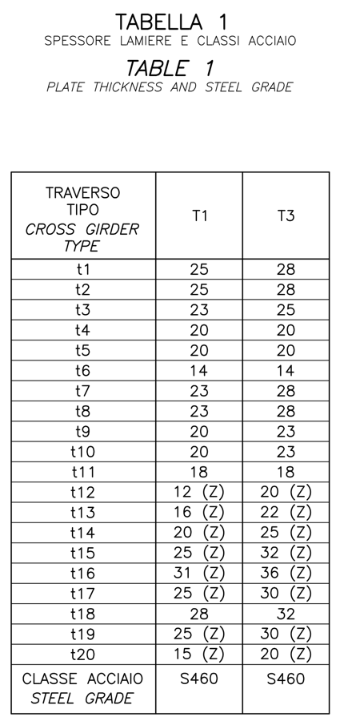

## Torri

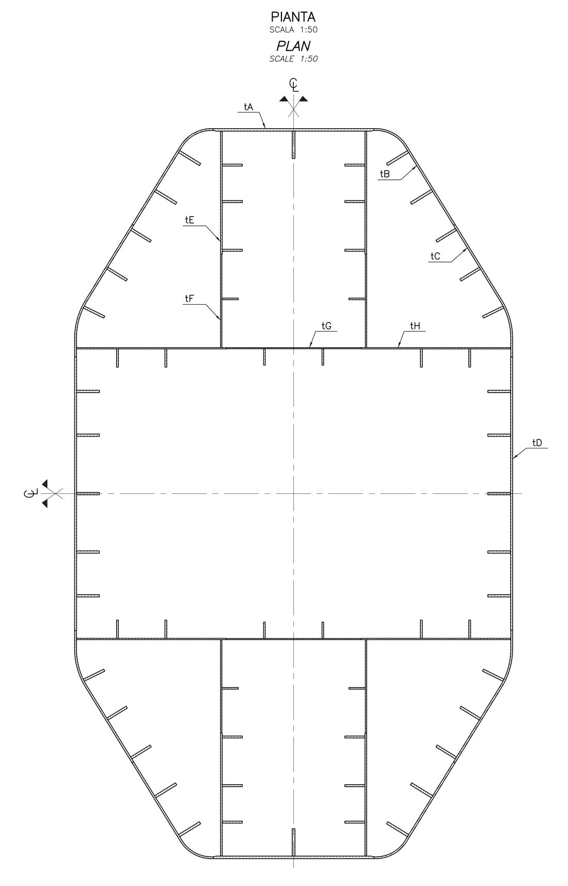
*Fonte: PS0019, PS0021 (spessori per conci), PS0022 (sezioni).*

Costruite dalle tavole (`scripts/messina_lamiere_torri.py`):

* **gamba**: 12 × 20 m senza rastremazione, lamiere d'estremità piane per 4,5 m,
  lamiere laterali piegate (raggi 1000 e 2000 mm), pareti interne a ±2000 e ±4000 mm,
  sette celle chiuse; irrigidimenti a piatto per pannello; 21 conci con spessori dalla
  tabella (diversi fra torre Sicilia e Calabria); S460;
* **traversi di torre**: cassone largo 8 m, alto 11,5 m in mezzeria, arco R 50 m
  fino a 14 m dall'asse e poi tratto rettilineo fino alle gambe (21,98 / 19,90 /
  17,80 m all'attacco); sei irrigidimenti per piattabanda e file d'irrigidimenti
  d'anima come nel dettaglio 1 della tavola. I parapetti da 1,5 m dell'appendice G
  non compaiono in queste tavole.

Rispetto a D-1 le gambe disegnate hanno in media il 5 % di materiale in più
(dispersione da −6 a +14 %, torsione fino a +20 %); i traversi di torre stanno
entro ±6-10 % tranne il n. 2 (−9 % sull'area nel tratto centrale). D-1 sembra
precedere le revisioni della torre descritte in PS0014 (irrigidimenti a piatto al
posto di quelli a T, diaframmi rivisti): il modello segue le tavole.

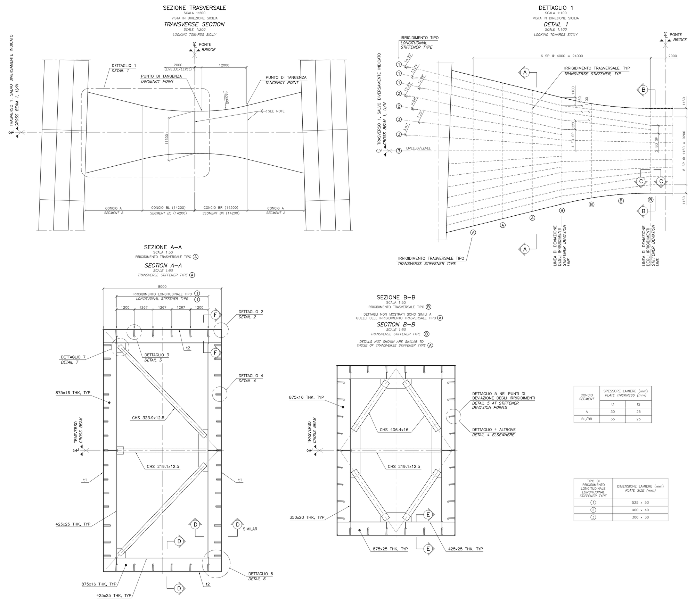

*Fonte: PS0003, Appendice A (uscita IBDAS, vista ortogonale): i nasi stanno ai due bordi esterni.*

{: .warning }
Le figure in prospettiva di PS0002 (fig. 2.3) e PS0003 (fig. 2.6) **non dicono da
che parte stia il naso**: una prima lettura lo metteva verso la fessura. Le
quote della tavola e il diaframma IBDAS lo mettono sul lato esterno, e solo così
il prodotto d'inerzia e il baricentro tornano con D-1.

### Costante di torsione

La costante di Saint-Venant di D-1 (Iv) è quella di **Bredt della sola cella
principale**: con la sezione della tavola la cella principale dà 0,9445 m⁴
contro 0,945 (CS1), 1,0191 contro 1,020 (CS2), 1,2103 contro 1,211 (CS8).
IBDAS trascura le celle chiuse dei trapezi, come si fa di solito per la torsione
globale dei cassoni; la teoria completa delle pareti sottili, che le include,
darebbe circa il 6-7 % in più. Nel modello si usa Iv di D-1.

### Sezione a lamiere e aree efficaci

Il cassone stradale è costruito con il modulo `feagent.lamiere`
([sezioni a lamiere con irrigidimenti](https://github.com/DomenicoGaudioso/feagent)),
lamiera per lamiera come in officina:

| Lamiera | Bordi | Irrigidimenti |
|---|---|---|
| piastra superiore, spessore a tratti t4, t1, t2, t3 | spigolo del naso e spigolo interno | 23 canalette RS1/RS2 (230/130/317 mm) e 4 piatti P2 174 × 16 |
| naso (t4) | punta e spigolo superiore | 2 piatti P1 152 × 14 |
| fondo (t5), retta e due archi | punta e spigolo interno | 13 canalette RS3 (500/170/240 mm) e 2 piatti P3 140 × 14 |
| chiusura della punta (t4) | naso e fondo | nessuno |

Le lamiere sono sulle loro linee medie; le proprietà lorde coincidono con il disegno
della tavola entro lo 0,2-1 % e con D-1 come prima (area +1,2 %, inerzie +1,0 e
+2,1 %). Diaframmi trasversali ogni 3,75 m e acciaio S420 (PS0076).

Il modulo calcola la **sezione efficace** di EN 1993-1-5 per qualsiasi stato di
sollecitazione: sottopannelli fra le canalette (4.4), pannelli irrigiditi come piastra
ortotropa (appendice A.1, come il foglio di verifica di IBDAS descritto in PS0076) e
come colonna (4.5.3), interpolazione (4.5.4), shear lag. È la base per le verifiche
dei cassoni con le combinazioni del modello.

## Cassone ferroviario

*Fonte: PS0102.*

Larghezza 7500 mm, altezza 2275 mm in asse, piastra superiore al 2 % verso i due
lati, anime verticali per 1000 mm poi inclinate, fondo largo con trapezi RF1,
quattro travi a T profonde sotto i binari (765 mm, anima 14, piattabanda 300 × 22).
Nel modello il contorno segue il diaframma IBDAS (colmo in mezzeria, anime
verticali fino al 47 % dell'altezza, fondo largo l'84 %) con le quattro travi a T
a 0,13, 0,33, 0,67 e 0,87 della larghezza; gli spessori sono tarati su D-1, che
riproduce entro lo 0,1 % (0,5 % sul concio CF4).

## Traversi dei pendini

Vedi [Traversi e collegamenti](05-traversi.html): cassone rettangolare largo 3,77 m
(lungo l'asse del ponte), alto da 1,5 a 4,7 m, con le sezioni di D-1 interpolate
nei nodi.

## Torri

Gamba: ottagono di circa 12 × 20 m con smussi da 2 m e pareti interne a croce,
irrigidimenti a piatto; traversi di torre: cassoni alti fino a 20,5 m con spigoli
rinforzati. Spessori e altezze degli irrigidimenti sono tarati sulle righe di D-1
(errori sotto lo 0,1 %).

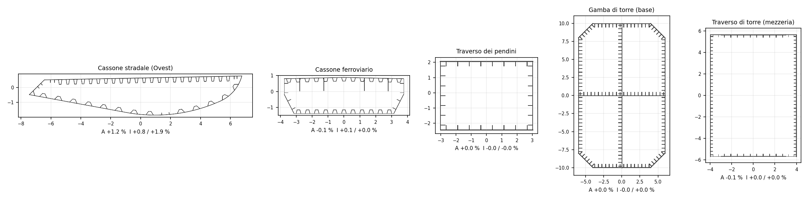
