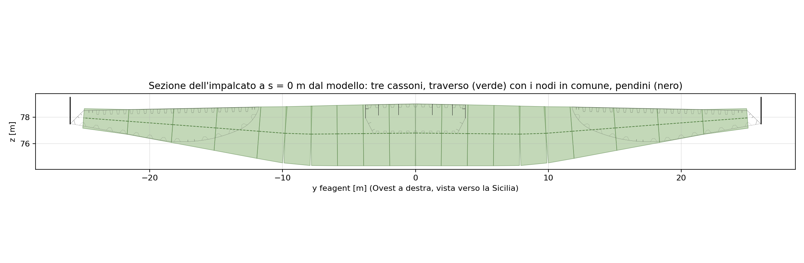
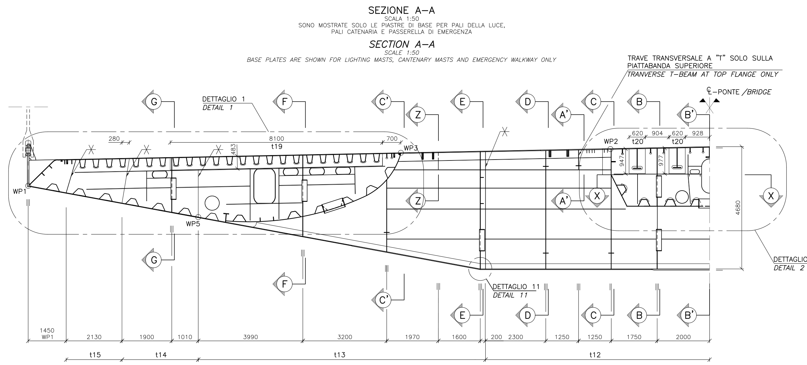

# Traversi e collegamenti: tre travi collegate dai traversi

L'impalcato è un **graticcio a tre travi longitudinali**: i due cassoni stradali
laterali e il cassone ferroviario centrale, con sezioni diverse, collegati ogni
30 m dai **traversi dei pendini**, che reggono anche i pendini alle estremità.

## Il traverso in IBDAS e nel modello

In IBDAS ogni traverso ha una **linea di nodi propria** (C-1, parti 4100-4400):
21 nodi da pendino a pendino, da y = −24,99 a +24,99 m, sull'asse baricentrico
del traverso, a quota 76,79 m in mezzeria e 77,94 m agli estremi (a s = 0). Gli
elementi sono 10 travi paraboliche a sezione variabile, con le proprietà di D-1
ai punti di Gauss.

Il modello feagent fa lo stesso:

* 21 nodi alle coordinate di C-1, 20 travi a sezione variabile;
* in ogni nodo le proprietà di D-1 interpolate linearmente fra i punti di Gauss;
* sezione: cassone rettangolare largo 3,77 m (lungo l'asse del ponte), alto da
  1,48 m agli estremi a 4,66 m in mezzeria, con le lamiere tarate su D-1;
* 117 traversi (uno per stazione dei pendini).

| y [m] | ±23,6 | ±19,7 | ±16,9 | ±13,2 | ±11,0 | ±8,7 | ±4,8 | ±0,8 |
|---|---|---|---|---|---|---|---|---|
| altezza D-1 [m] | 1,48 | 2,27 | 2,84 | 3,60 | 4,08 | 4,44 | 4,59 | 4,66 |
| altezza dalla tavola PS0115 [m] | 1,52 | 2,35 | 2,94 | 3,74 | 4,21 | 4,68 | 4,68 | 4,68 |

*Fonte: PS0115. La piattabanda inferiore è rettilinea dall'attacco del pendino
fino a 8,75 m dall'asse del ponte, poi orizzontale a 4680 mm.*

Le altezze di D-1 seguono la tavola con scarti del 3-5 %, dovuti alla pendenza
della piastra superiore e al fatto che D-1 è riferita ai punti di Gauss.

## Collegamenti: solo travi, nodi in comune

Tutto l'impalcato è fatto di **elementi trave**, senza gusci e senza elementi di
collegamento:

| Collegamento | In IBDAS (C-2) | Nel modello feagent |
|---|---|---|
| traverso - cassoni | i nodi 3, 11 e 19 del traverso sono slave dei nodi dei tre cassoni, senza rilasci | il traverso **usa gli stessi nodi** dei tre cassoni |
| pendino - traverso | il nodo inferiore del pendino è slave del nodo di estremità del traverso | l'estremo del traverso **è il nodo inferiore del pendino** |

L'asse del traverso non passa per il baricentro dei cassoni (a s = 0 è 0,6-1,3 m
più in basso) né per l'attacco del pendino (1 m più all'esterno). Lo scostamento
entra come **eccentricità d'estremità** delle travi del traverso (offset rigidi
interni all'elemento, nel sistema globale), così l'asse deformabile del traverso
resta dov'è in IBDAS e non servono bracci rigidi separati.

## Tipi di traverso e pesi

Il peso integrato di D-1 lungo il traverso riconosce il tipo della tabella 3.2 di
PS0002 entro lo 0,2 %:

| Tipo | Peso modellato PS0002 [kN] | Peso integrato da D-1 [kN] | Calibrazione PS0002 [kN] | Stazioni |
|---|---|---|---|---|
| T1 | 1181 | 1179 | 433 | 107 |
| T3 | 1647 | 1645 | 388 | 4 |
| T4a | 3624 | 3619 | 4051 | 2 |
| T4b | 2874 | 2871 | 1279 | 2 |
| T6 | 2301 | 2298 | 649 | 2 |

Sulla calibrazione vedi [Carichi permanenti](06-carichi.html).

## Prima e dopo

Nella prima versione del modello il traverso era fatto di 4 elementi appesi ai
nodi dei cassoni, alla quota dei cassoni e non a quella del suo asse; poi è
passato alla linea di nodi propria di IBDAS con bracci rigidi verso cassoni e
pendini; ora usa i nodi in comune con le eccentricità d'estremità. Il modello ha
3967 nodi e la modale si fa con il solutore sparso di feagent, esteso ai cavi per
questo modello.
