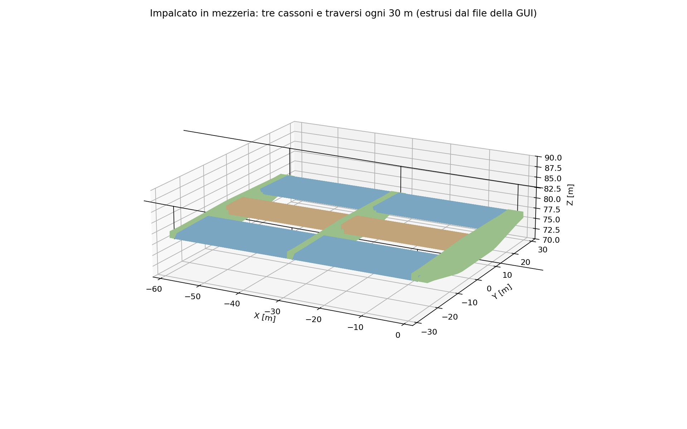
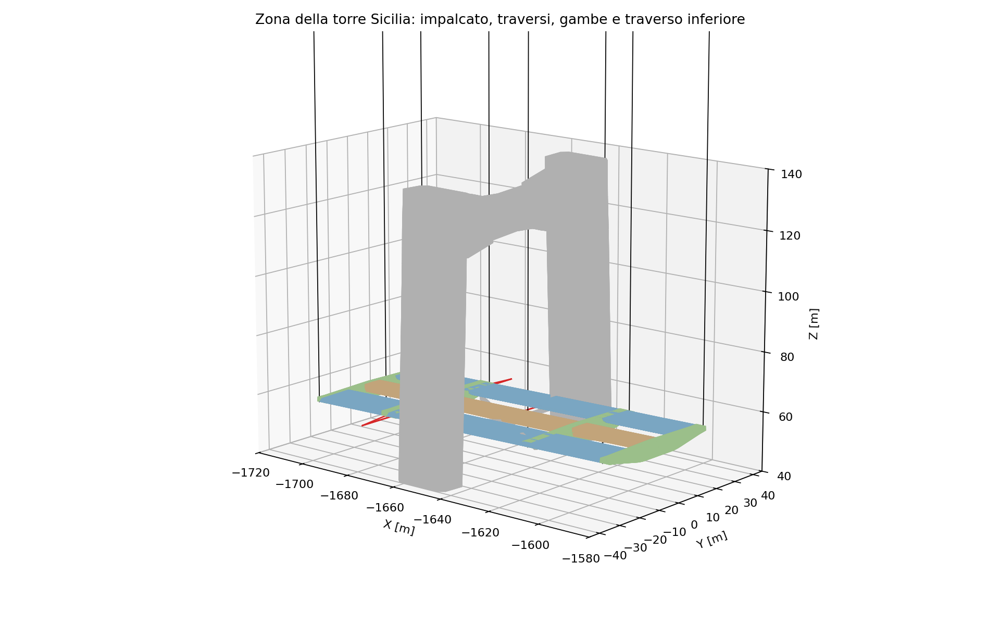
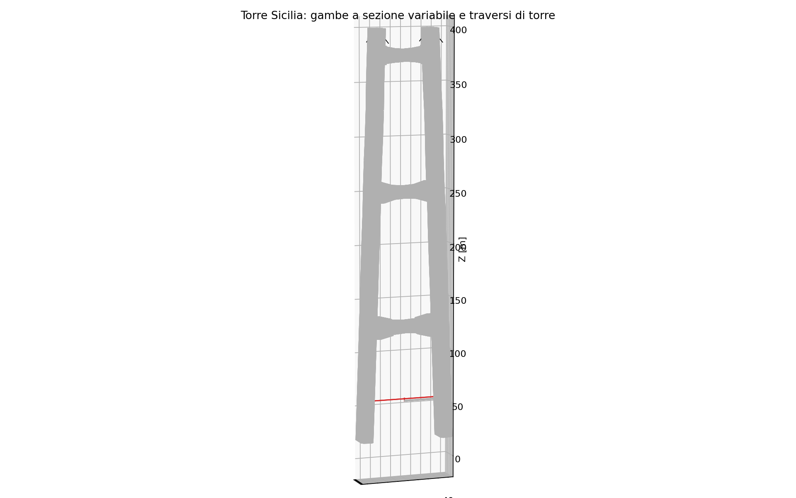

# Vista estrusa in feagent

Il modello si apre nella GUI di feagent dal file
`examples/ponte_stretto_messina/ponte_stretto_messina.xlsx`. La vista estrusa
(tasto **E**) serve a controllare a colpo d'occhio che ogni trave abbia la
sezione giusta, nella posizione giusta e con l'orientamento giusto.

## Una correzione della GUI nata da questo controllo

Il primo controllo ha mostrato una "parete" alta circa 17 m sotto l'impalcato. La
GUI disegnava ogni trave come un rettangolo pieno equivalente ricavato da A, Iy e
Iz: per un cassone in parete sottile quel rettangolo è alto quasi il triplo della
sezione vera. Il foglio delle parti di sezione non veniva usato.

Ora la vista estrusa usa le **parti delle sezioni composte** (foglio
`SectionPart`), nelle coordinate di riferimento della trave come il disegno delle
tensioni, anche sulle travi a sezione variabile. Sull'intero ponte le parti
supererebbero il limite di facce della vista, e la GUI estrude il **contorno
esterno** di ciascuna sezione; isolando un tratto (selezione e tasto **I**) si
vedono tutte le lamiere e gli irrigidimenti.

## Figure dal file della GUI

Le figure che seguono sono disegnate dallo script `messina_figure_doc.py`
leggendo lo stesso file Excel che apre la GUI: nodi, assi locali, eccentricità
d'estremità, parti di sezione, travi a sezione variabile, cavi.

*I tre cassoni (stradali in azzurro, ferroviario in ocra) corrono continui; i
traversi (verdi) li attraversano ogni 30 m sui nodi in comune e finiscono
all'attacco dei pendini (neri).*

*Sezione a s = 0 m: lamiere dei tre cassoni, prospetto del traverso (altezza da
1,5 a 4,7 m) e attacchi dei pendini.*

*Zona della torre Sicilia: le gambe a sezione variabile e il traverso inferiore,
l'impalcato che passa fra le gambe con i traversi dei pendini.*

*Torre Sicilia: gambe a sezione variabile e tre traversi di torre.*

## Cosa si è controllato

* i tre cassoni hanno la sezione delle tavole, con il naso dei cassoni stradali
  verso l'esterno e la piastra superiore in pendenza;
* i traversi stanno sull'asse di C-1, sotto i cassoni, con i nodi in comune ed
  eccentricità d'estremità, senza bracci rigidi;
* i pendini si attaccano alle estremità dei traversi;
* le gambe delle torri hanno l'ottagono con le pareti interne, ruotato come in
  D-1;
* nessuna sezione è ruotata di 90 gradi: l'asse y locale dei cassoni è
  orizzontale (ruotato dell'angolo principale di circa 1,5 gradi).
