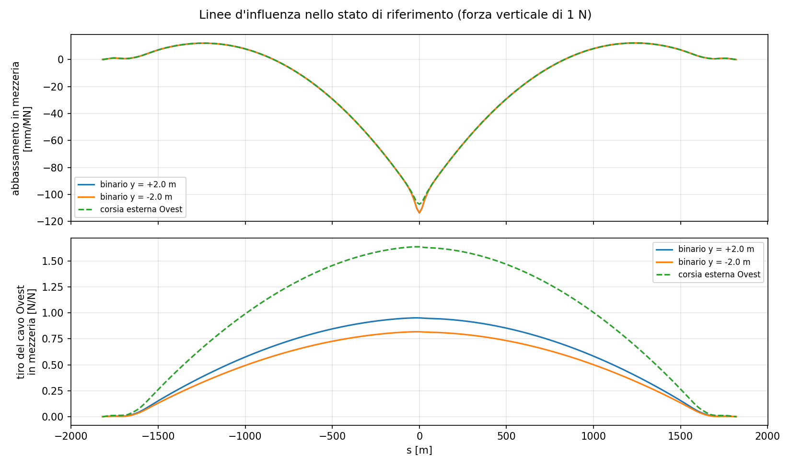
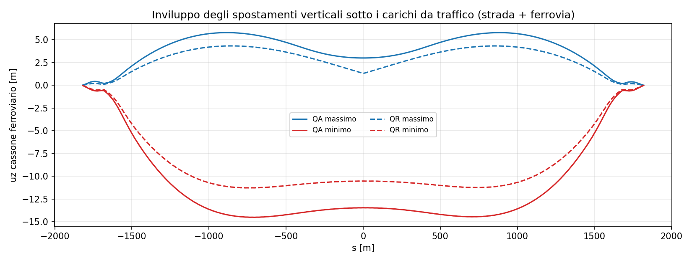
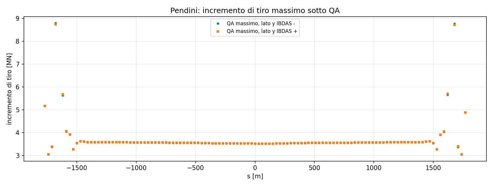
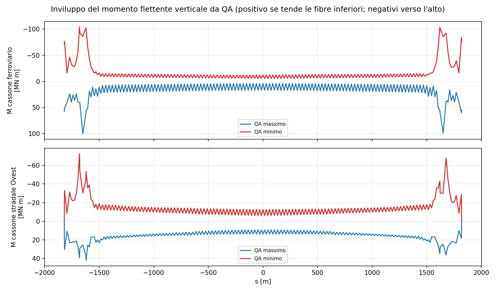
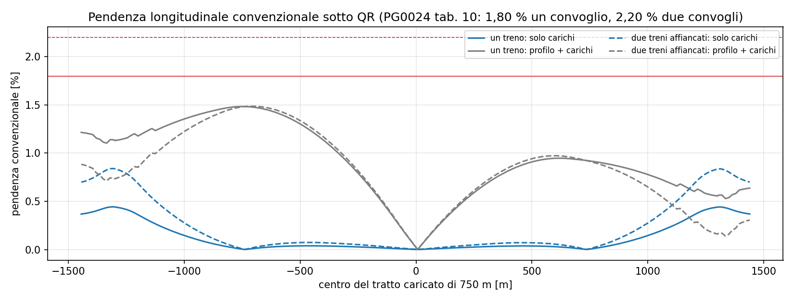
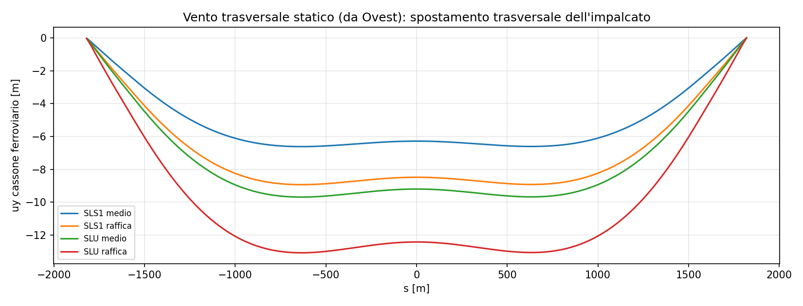

# Carichi mobili e vento

Il ponte porta due carreggiate stradali (sui cassoni laterali) e due binari (sul
cassone centrale). Le azioni variabili globali sono quelle dei **Fondamenti
Progettuali PG0024**: il carico da traffico "di macrolivello" (par. 5.2.2), pensato
per cavi, pendini, torri, ancoraggi e per la deformabilità ai fini della
percorribilità, e il vento (par. 5.3.1), con i coefficienti aerodinamici
dell'appendice G di PS0002.

## Metodo: linee d'influenza sullo stato di riferimento

Un ponte sospeso è non lineare, ma attorno allo stato dei permanenti si comporta
quasi linearmente per carichi che non cambiano la forma dei cavi in modo
sostanziale. Le azioni variabili si studiano quindi sulla **rigidezza tangente**
dello stato di riferimento (permanenti PP + PN, controfreccia delle torri, cavi e
pendini ai tiri E-3): travi lineari più la rigidezza materiale e geometrica di
cavi e pendini al tiro dei permanenti. È la stessa linearizzazione della modale e
del metodo di Newton.

1. In ogni stazione dei tre cassoni (pendini, punti medi, giunti) si applica una
   forza verticale unitaria e una coppia torcente unitaria; sul cassone
   ferroviario anche una forza longitudinale unitaria. La rigidezza tangente si
   fattorizza una volta sola.
2. Per ogni grandezza (abbassamenti, rotazioni, tiri dei cavi e dei pendini,
   spostamenti delle selle, momenti flettenti e torcenti dei cassoni, sollecitazioni
   alla base delle torri) si ottiene la linea d'influenza.
3. Una corsia o un binario eccentrico rispetto al nodo del cassone è la somma della
   forza e della coppia: la linea d'influenza della corsia a y è
   η(s) = η<sub>F</sub>(s) − (y − y<sub>cassone</sub>) η<sub>M</sub>(s).
4. I carichi si dispongono sulle linee d'influenza nel modo più sfavorevole per
   ciascuna grandezza.
5. Le disposizioni che governano si rifanno con la **statica non lineare**
   (Newton dallo stato di riferimento) per misurare l'errore della
   linearizzazione.

## Carichi da traffico (PG0024 par. 5.2.2)

| | Strada, per ciascuna carreggiata | Ferrovia, per ciascun binario |
|---|---|---|
| **QA** carico addensato (capacità portante) | corsia più caricata 15 kN/m, ciascuna delle altre due 5 kN/m; stese anche frazionate | due treni lunghi 750 m di α·q = 1,1 · 80 = 88 kN/m, distanti almeno 750 m |
| **QR** carico rarefatto (deformabilità, percorribilità) | corsia più caricata 3,75 kN/m, una seconda corsia 1,25 kN/m | un treno lungo 750 m di 88 kN/m |
| azioni longitudinali | frenatura pari a 1/10 della stesa | avviamento 33 kN/m · λ ≤ 1000 kN, frenatura 20 kN/m · λ ≤ 6000 kN; anche due treni in versi opposti, uno in avviamento e l'altro in frenatura |

Nel modello:

* corsie di ogni carreggiata con l'asse a |y| = 22,48, 18,76 e 14,92 m (corsia di
  emergenza esterna e due corsie di marcia, dalla sezione della tavola PS0093);
* binari a y = ±2,0 m (tavola PS0102);
* le stese stradali coprono le parti della linea d'influenza di segno utile,
  anche frazionate; la corsia "più caricata" è quella con l'effetto maggiore;
* i treni sono finestre di 750 m che si spostano lungo il ponte, anche in parte o
  del tutto oltre i giunti (un treno fuori dall'impalcato sospeso non dà effetto);
  per QA la posizione dei due treni è la coppia migliore a distanza non minore
  di 750 m;
* le due carreggiate e i due binari sono caricati insieme, come prescrive
  PG0024;
* le azioni longitudinali sono 6000 + 1000 kN per i due binari (due treni in versi
  opposti, uno in frenatura e uno in avviamento) sulla finestra peggiore e la
  frenatura stradale di una carreggiata (2,5 kN/m su tutto l'impalcato); si sommano
  in valore assoluto agli effetti verticali.

## Vento statico (PG0024 par. 5.3.1, PS0002 par. 6.3 e appendice G)

Profilo della velocità media del vento (10 minuti):

*u(z) = α<sub>r</sub> · u<sub>ref</sub> · k<sub>r</sub> · ln(z / z<sub>0</sub>)*, con
u<sub>ref</sub> = 29 m/s, k<sub>r</sub> = 0,17, z<sub>0</sub> = 0,01 m.

| Livello | SLS1 | SLS2 | SLU | SLIS |
|---|---|---|---|---|
| α<sub>r</sub> | 1,00 | 1,07 | 1,21 | 1,35 |
| u a 70 m [m/s] | 44 | 47 | 54 | 60 |

La pressione è *q = ½ ρ u²* con ρ = 1,25 kg/m³ (densità dell'aria non indicata nei
documenti, valore usuale). La **raffica statica** di PS0002 par. 6.3 vale 1,35
volte la pressione del vento medio.

Coefficienti aerodinamici (vento perpendicolare all'asse del ponte):

| Parte | Larghezza di riferimento | C<sub>D</sub> | C<sub>L</sub> | Fonte |
|---|---|---|---|---|
| cassone stradale sopravento | 14,22 m | 0,257 (0,283 con traffico) | −0,203 (−0,179) | app. G tab. 2.3; PS0002 par. 6.3.1 |
| cassone ferroviario | 7,5 m | 0,189 (0,208) | −0,074 (−0,010) | idem |
| cassone stradale sottovento | 14,22 m | 0,099 (0,109) | −0,085 (−0,091) | idem |
| coppia di cavi principali (per lato) | 1,263 m (diametro di un cavo) | 0,5 sopravento − 0,1 sottovento | | app. G par. 2.5 |
| pendini | diametro del pendino | 0,8 | | app. G par. 2.4 |
| gamba della torre sopravento | 20 m | 1,8 (sottovento 0 a 0 gradi) | | app. G tab. 2.7 |

C<sub>L</sub> negativo è una forza verso il basso. Il coefficiente di momento del
solo cassone ferroviario (0,0111) dà una coppia trascurabile rispetto a quella
prodotta dalla differenza di portanza fra i due cassoni stradali e non si applica.
Il vento soffia da Ovest (verso y− nel modello): il ponte è simmetrico, il vento da
Est dà gli stessi risultati specchiati. Il carico da traffico con vento si
considera solo al livello SLS1 (completa funzionalità).

## Riscontro con i casi di validazione IBDAS

La relazione di validazione del modello globale (PS0005) riporta dieci casi
statici calcolati con IBDAS sullo stato di riferimento. Cinque servono a
controllare proprio la risposta alle azioni variabili:

| Caso | Carico |
|---|---|
| LC1 | 2 × 5000 kN verticali in mezzeria, agli attacchi dei pendini |
| LC2 | 2 × 5000 kN verticali a 330 m dalla torre Sicilia |
| LC7 | 25 kN/m verticali su metà larghezza, per tutta la lunghezza |
| LC9 | 10 kN/m trasversali su tutta la lunghezza dell'impalcato |
| LC10 | 3 × 25 kN/m verticali su metà lunghezza |

Gli spostamenti e i tiri di IBDAS sono quelli della condizione "riferimento + LCn"
meno quelli della condizione di riferimento.

### Risultati del riscontro

Variazioni dalla condizione di riferimento, feagent (linearizzato) | IBDAS. Il
modello feagent ha gli ammortizzatori bloccati (fisso-fisso), come IBDAS in LC2,
LC7 e LC9; in LC1 e LC10 IBDAS li ha liberi, quindi gli spostamenti longitudinali
non sono confrontabili.

| Grandezza | LC1 | LC2 | LC7 (lato Ovest) | LC9 | LC10 |
|---|---|---|---|---|---|
| abbassamento del cavo in mezzeria [m] | −1,05 \| −1,16 | +0,12 \| +0,13 | −2,49 \| −2,84 | | −2,24 \| −2,46 |
| tiro del cavo in mezzeria [MN] | +8,8 \| +9,2 | +3,0 \| +3,1 | +81,0 \| +82,5 | +0,3 \| +0,6 | +71,4 \| +74,0 |
| tiro del cavo alla sella Sicilia, campata centrale [MN] | +9,0 \| +9,4 | +5,0 \| +5,0 | +88,3 \| +89,6 | +0,4 \| +0,6 | +89,7 \| +86,0 |
| tiro del cavo all'ancoraggio Sicilia [MN] | +9,0 \| +9,5 | +3,7 \| +3,8 | +78,5 \| +81,7 | +0,7 \| +0,5 | +80,7 \| +77,9 |
| spostamento longitudinale della sella Sicilia [m] | | +0,013 \| +0,014 | +0,28 \| +0,30 | | |
| spostamento trasversale dell'impalcato in mezzeria [m] | | | | −6,27 \| −6,64 | |

I tiri tornano entro il 2-4 %, lo spostamento trasversale entro il 6 %; gli
abbassamenti del cavo sono il 10-12 % più piccoli di IBDAS. Il caso LC7 ha
anche mostrato un difetto del modello, poi corretto: il pendolo della sella di
deviazione era incastrato e tratteneva il cavo (all'ancoraggio +56 MN invece di
+82 MN); ora è a cerniera.

## Risultati: carichi da traffico

Effetti dei soli carichi variabili (sopra lo stato dei permanenti), disposti nel
modo più sfavorevole per ciascuna grandezza.



*Linee d'influenza dell'abbassamento in mezzeria e del tiro del cavo per una forza
su un binario e sulla corsia esterna: la parte negativa vicino alle torri è quella
che le stese "frazionate" lasciano scarica.*

### Spostamenti

| Grandezza | QA | QR |
|---|---|---|
| abbassamento del ferroviario in mezzeria [m] | −13,5 (strada −3,7, ferrovia −9,8) | −10,5 |
| sollevamento del ferroviario in mezzeria [m] | +3,0 | +1,3 |
| abbassamento massimo lungo l'impalcato [m] | −14,5 (a s ≈ ±720 m) | −11,3 |
| sollevamento massimo lungo l'impalcato [m] | +5,8 | +4,3 |
| rotazione torsionale massima del ferroviario [%] | 9,4 | 3,5 |
| spostamento longitudinale della sella, torre Sicilia [m] | +1,02 | +0,50 |
| spostamento longitudinale della sella, torre Calabria [m] | −0,80 | −0,39 |
| spostamento longitudinale ai giunti [m] | ±0,03 | ±0,02 |



### Tiri

| Grandezza (per lato) | Permanenti [MN] | QA [MN] | QR [MN] |
|---|---|---|---|
| cavo in mezzeria | 1291 | +277 (+21 %) | +135 |
| cavo alla sella, campata centrale | 1384 | +300 (+22 %) | +144 |
| cavo alla sella, campata laterale | 1407 | +295 | +144 |
| cavo all'ancoraggio Sicilia | 1328 | +288 | +141 |
| pendino più sollecitato (s = −1680 m) | 9,8 | +8,8 | |

Il carico da traffico QA vale circa un quinto del tiro dei permanenti nei cavi;
nei pendini l'incremento medio è l'89 % del tiro dei permanenti, perché un
pendino sente il carico di 30 m di impalcato. Il ferroviario pesa per circa due
terzi dell'incremento (176 dei 277 MN in mezzeria).



### Sollecitazioni dei cassoni e delle torri

| Grandezza | QA |
|---|---|
| momento flettente del ferroviario [MN m] | +100 / −104, alle torri |
| momento flettente del cassone stradale Ovest [MN m] | +42 / −73, alle torri |
| momento torcente del ferroviario [MN m] | 36 |
| momento torcente del cassone stradale [MN m] | 25 |
| momento longitudinale alla base della gamba, torre Sicilia [MN m] | +1728 / −312 |
| sforzo normale alla base della gamba, torre Sicilia [MN] | −236 |



*Momento flettente nel piano verticale, positivo se tende le fibre inferiori,
negativi verso l'alto. Lungo la campata corrente l'impalcato lavora come trave
continua su appoggi elastici (i pendini ogni 30 m); i picchi stanno alle torri,
dove l'impalcato passa dai pendini ai collegamenti con le torri.*

### Verifica non lineare

La disposizione QA che massimizza l'abbassamento in mezzeria, rifatta con la
statica non lineare (Newton dallo stato di riferimento, 5 iterazioni):

| Grandezza | lineare | non lineare |
|---|---|---|
| abbassamento del ferroviario in mezzeria [m] | −13,47 | −12,04 |
| tiro del cavo Ovest in mezzeria [MN] | +180,6 | +179,2 |
| spostamento longitudinale della sella Sicilia [m] | +0,66 | +0,63 |

La linearizzazione sovrastima l'abbassamento del 12 % (il cavo si irrigidisce
quando cambia forma) e coglie i tiri entro l'1 %. Gli inviluppi degli spostamenti
verticali qui riportati sono quindi a favore di sicurezza.

### Percorribilità (PG0024 tab. 10 e 12)

Pendenza longitudinale convenzionale sotto i carichi QR, sul tratto di 750 m
occupato dai treni, con le 2 + 2 stese stradali QR sullo stesso tratto:

| Caso | Solo carichi [%] | Profilo + carichi [%] | Limite [%] |
|---|---|---|---|
| un treno | 0,44 | 1,48 | 1,80 |
| due treni affiancati | 0,84 | 1,49 | 2,20 (SLS1), 2,00 (SLS2) |

Il profilo longitudinale di progetto da solo ha già una pendenza media fino a
1,58 % su 750 m vicino alla torre Sicilia. La pendenza convenzionale massima con i
carichi resta sotto i limiti in entrambe le letture della definizione. La rotazione
trasversale sotto QR (3,5 %) è sotto l'8 % (ferrovia, SLS1) e il 7 % (strada).



## Risultati: vento statico

Vento trasversale da Ovest, profilo logaritmico; "medio" = pressione del vento
medio, "raffica" = 1,35 volte.

| Livello | u a 70 m [m/s] | Spostamento trasversale dell'impalcato in mezzeria [m] | Cavo in mezzeria [m] | Sella Sicilia [m] | Tiro cavo sopravento / sottovento [MN] | Momento orizzontale del ferroviario [MN m] | Momento trasversale alla base, gamba sopravento [MN m] |
|---|---|---|---|---|---|---|---|
| SLS1 medio | 44 | −6,3 | −5,9 | −0,55 | +13,0 / +8,2 | 332 | 1044 |
| SLS1 raffica | 44 | −8,5 | −8,0 | −0,75 | +17,6 / +11,0 | 449 | 1410 |
| SLS1 raffica, con traffico | 44 | −9,1 | −8,6 | −0,78 | +14,4 / +9,7 | 485 | 1449 |
| SLU medio | 53 | −9,2 | −8,7 | −0,81 | +19,1 / +12,0 | 487 | 1529 |
| SLU raffica | 53 | −12,4 | −11,7 | −1,09 | +25,7 / +16,2 | 657 | 2064 |
| SLIS raffica | 59 | −15,5 | −14,6 | −1,36 | +32,0 / +20,1 | 818 | 2569 |



Il vento porta l'impalcato fuori asse di 6-15 m secondo il livello, e il cavo
quasi di altrettanto: l'impalcato "pende" dai cavi come un pendolo e la
rigidezza trasversale viene soprattutto dal tiro dei cavi. Le forze di portanza
(C<sub>L</sub> negativo) abbassano l'impalcato in mezzeria di 0,3-0,8 m e lo
ruotano di meno dell'1 %.

La raffica SLU rifatta con la statica non lineare:

| Grandezza | lineare | non lineare |
|---|---|---|
| spostamento trasversale dell'impalcato in mezzeria [m] | −12,42 | −12,20 |
| tiro del cavo sopravento in mezzeria [MN] | +25,7 | +26,3 |
| tiro del cavo sottovento in mezzeria [MN] | +16,2 | +16,8 |
| abbassamento dell'impalcato in mezzeria [m] | −0,67 | −0,49 |

Per il vento la linearizzazione è buona entro il 2-4 % sugli spostamenti
trasversali e sui tiri.

## Cosa manca

* vento longitudinale e a 45 gradi (coefficienti in PS0002 app. G, tab. 2.5 e 2.7);
* risposta dinamica al vento turbolento (buffeting) e accelerazioni del piano
  viario (PG0024 tab. 12);
* percorribilità dinamica con i sei treni reali RFI (PG0024 par. 5.2.3);
* carichi locali QL (LM71, SW/0, SW/2, schemi NTC) per le verifiche di
  impalcato, traversi e pendini.

## Riproducibilità

```bash
python scripts/messina_azioni_variabili.py --nonlineare
```

Lo script legge lo stato di riferimento calcolato da `messina_ibdas_model.py` e
scrive `messina_out/azioni_variabili.json` e le figure di questa pagina.
