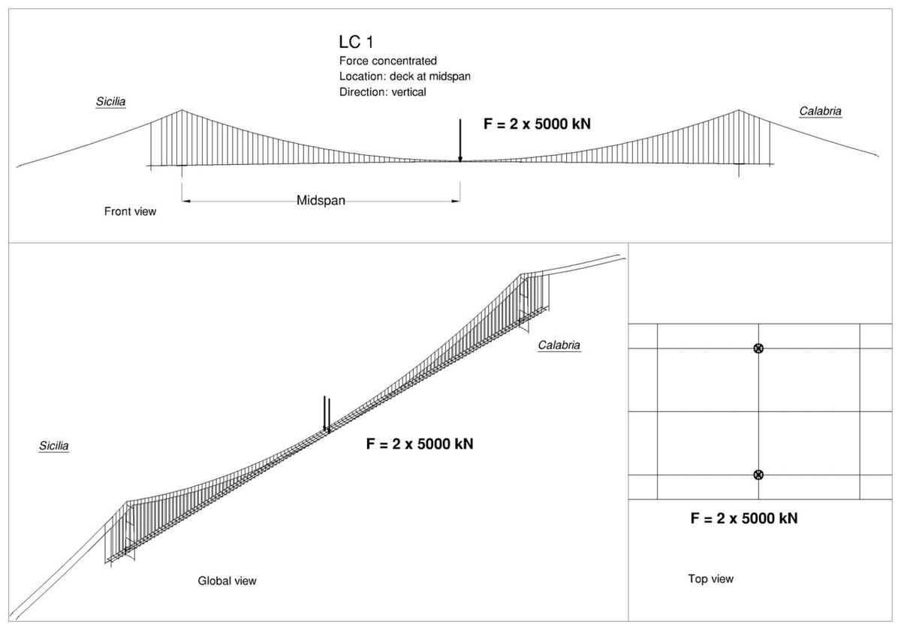
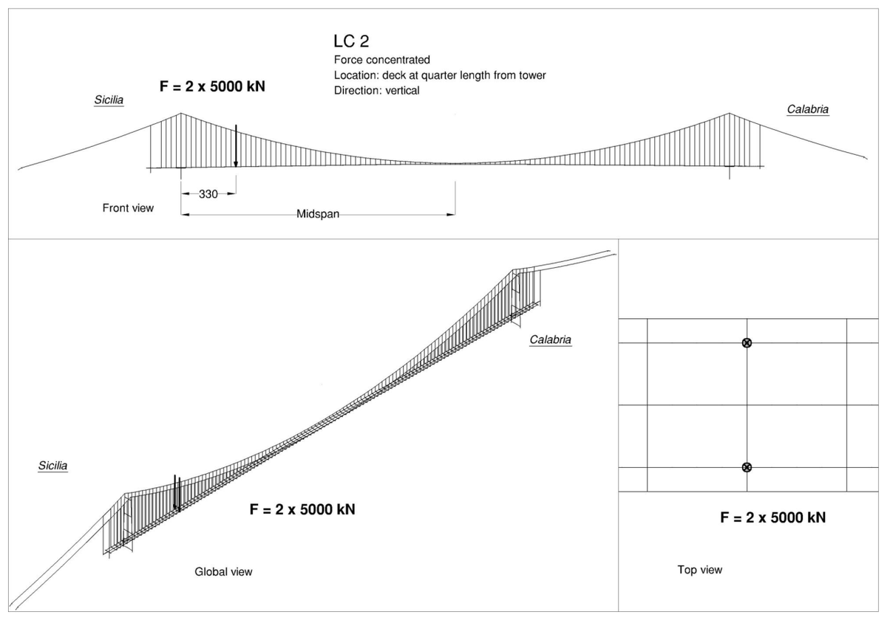
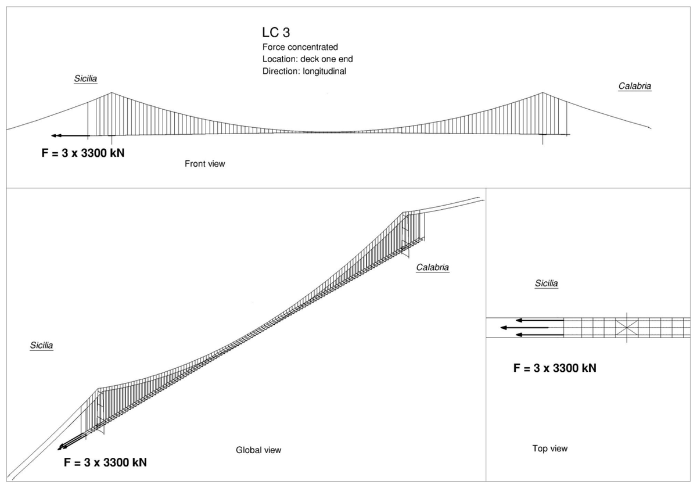
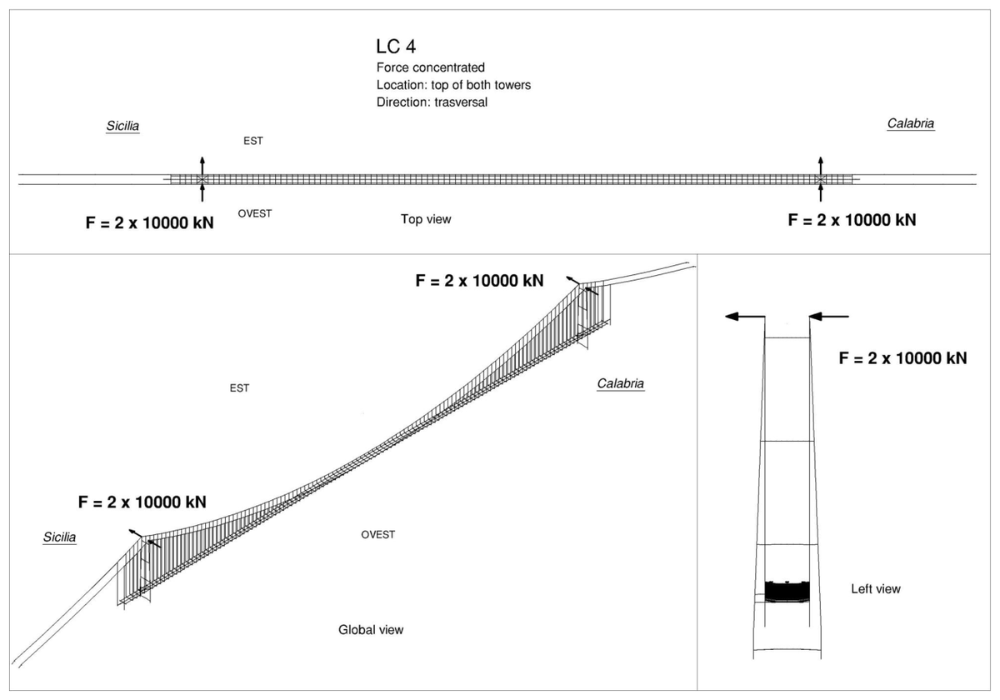
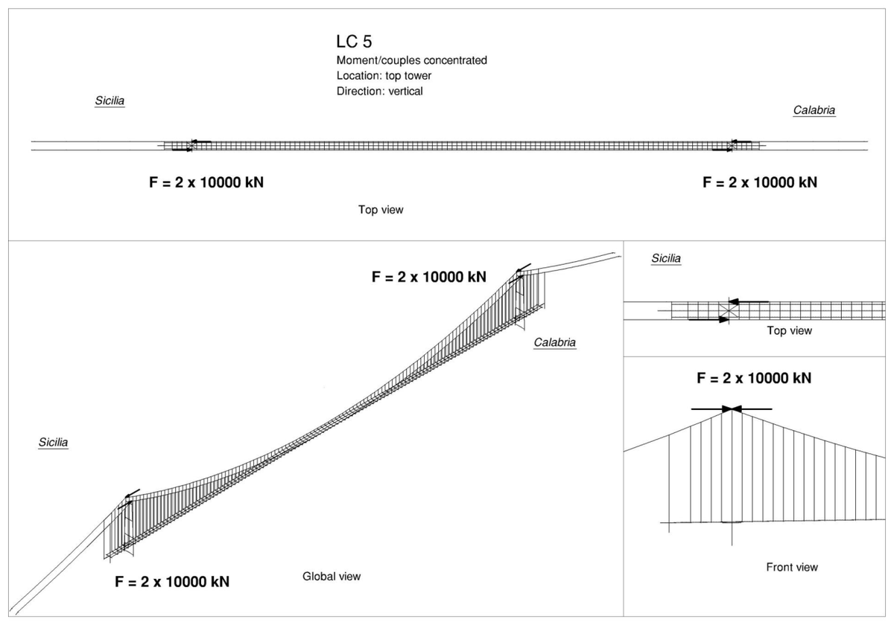
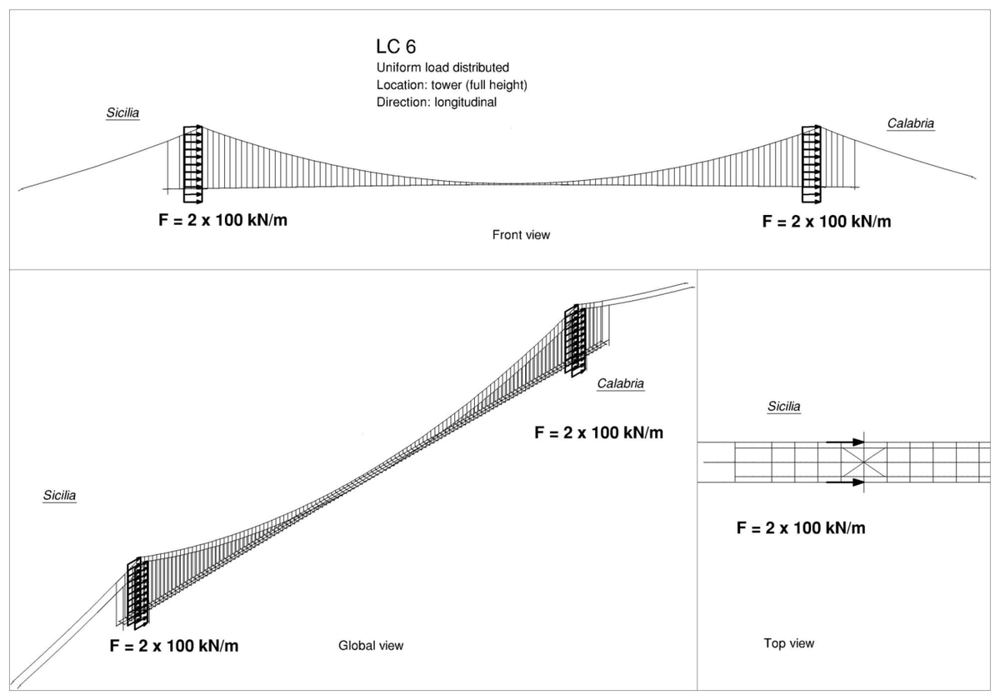
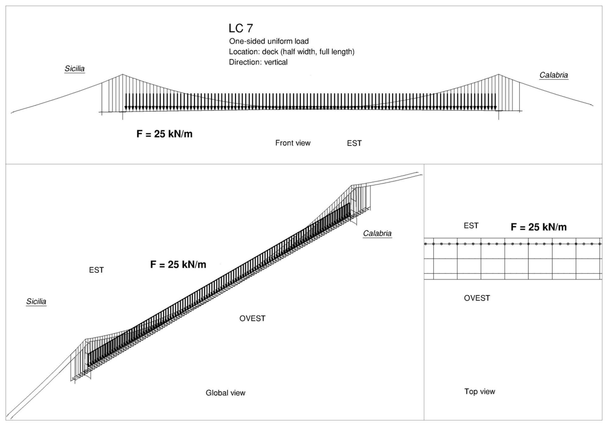
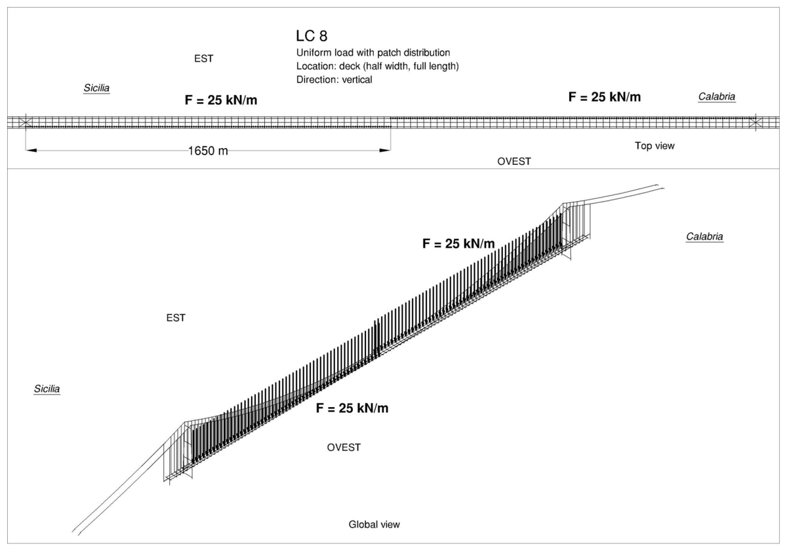
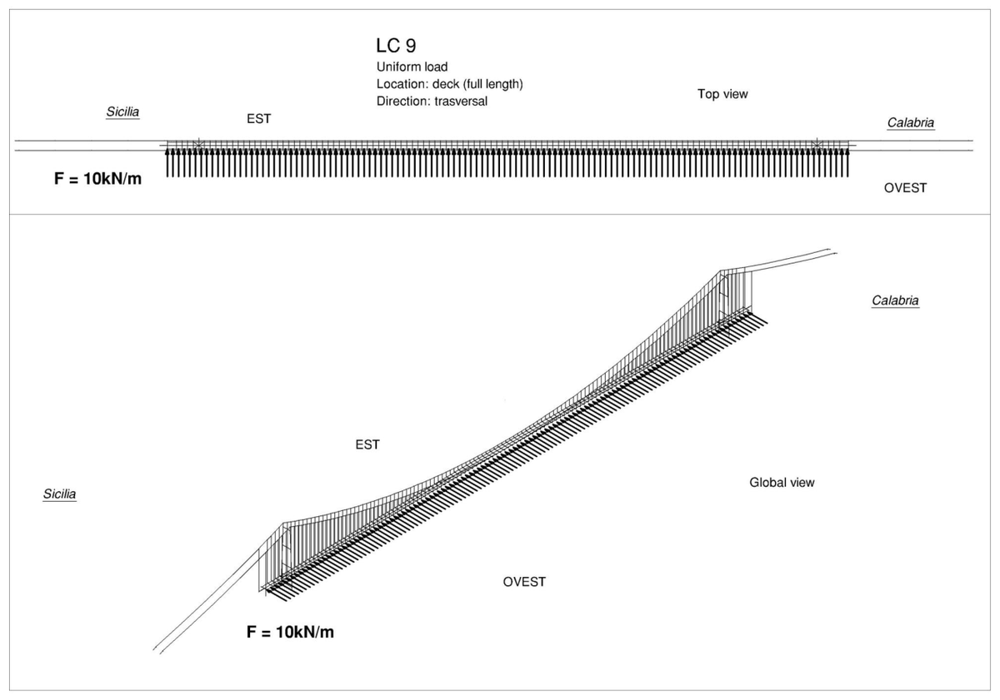
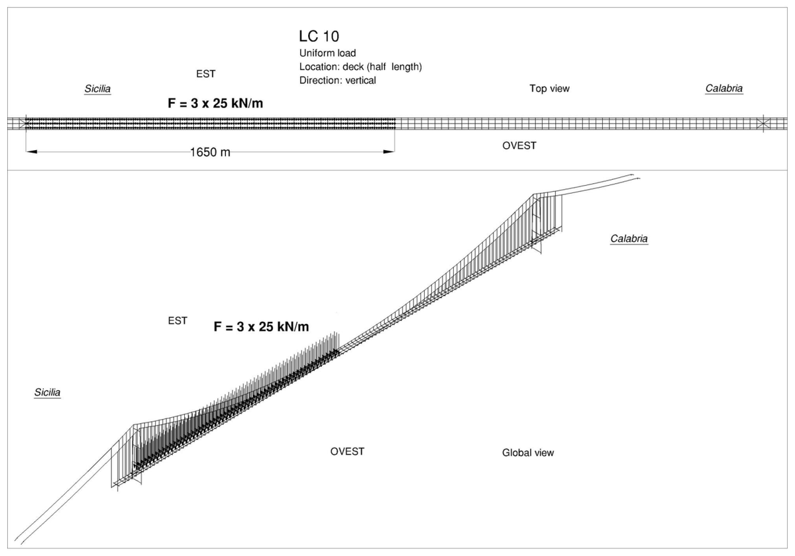

# Casi di validazione PS0005: input e output

La relazione di validazione del modello globale (PS0005) riporta dieci casi statici
calcolati con IBDAS sullo stato di riferimento. Per ciascuno: lo **schema del carico**
di PS0005, il **carico come è applicato** nel modello feagent e **tutte le grandezze**
che PS0005 riporta, modello contro IBDAS. Le uscite IBDAS sono la condizione
"riferimento + LCn" meno la condizione di riferimento; il modello feagent è
linearizzato sullo stato di riferimento (vedi [Carichi mobili e vento](14-mobili-vento.html)),
con gli ammortizzatori bloccati o liberi come il caso di PS0005.

Assi IBDAS: s lungo il ponte verso la Calabria, y trasversale con l'Ovest a y negativo,
z verso l'alto. Cavo e impalcato del lato Ovest. Spostamenti in metri, tiri in MN.
Lo scarto si riporta quando la grandezza IBDAS supera l'1 % della massima del caso.

## LC1, ammortizzatori libero-libero

**Input.** 2 x 5000 kN verticali verso il basso in mezzeria, agli attacchi dei pendini. Risultante applicata al modello: Fx = +0,00 MN, Fy = +0,00 MN, Fz = −10,00 MN (assi feagent).

*Schema del carico LC1 (PS0005, pag. 12).*

**Output.**

| Grandezza | feagent | IBDAS | Scarto |
|---|---|---|---|
| cavo, s = -1650 m: us [m] | +0,031 | +0,034 | −9 % |
| cavo, s = -1650 m: uy [m] | +0,000 | +0,000 |  |
| cavo, s = -1650 m: uz [m] | −0,001 | −0,002 |  |
| cavo, s = +0 m: us [m] | +0,003 | +0,003 |  |
| cavo, s = +0 m: uy [m] | −0,000 | +0,001 |  |
| cavo, s = +0 m: uz [m] | −1,049 | −1,164 | −10 % |
| cavo, s = +1650 m: us [m] | −0,025 | −0,028 | −11 % |
| cavo, s = +1650 m: uy [m] | +0,000 | +0,000 |  |
| cavo, s = +1650 m: uz [m] | −0,001 | −0,002 |  |
| tiro del cavo, s = -2620 m [MN] | +9,15 | +9,51 | −4 % |
| tiro del cavo, s = -2513 m [MN] | +9,10 | +9,52 | −4 % |
| tiro del cavo, s = -1665 m [MN] | +9,30 | +9,71 | −4 % |
| tiro del cavo, s = -1635 m [MN] | +9,07 | +9,37 | −3 % |
| tiro del cavo, s = -15 m [MN] | +8,89 | +9,17 | −3 % |
| tiro del cavo, s = +1635 m [MN] | +9,08 | +9,37 | −3 % |
| tiro del cavo, s = +1665 m [MN] | +9,27 | +9,64 | −4 % |
| tiro del cavo, s = +1911 m [MN] | +9,11 | +9,48 | −4 % |
| tiro del cavo, s = +2470 m [MN] | +9,14 | +9,44 | −3 % |
| tiro del tie-down, s = -1833 m [MN] | +0,48 | +0,49 | −2 % |
| tiro del tie-down, s = +1833 m [MN] | +0,42 | +0,43 | −2 % |
| impalcato, giunto Sicilia, cassone Ovest: us [m] | −0,007 | −0,003 |  |
| impalcato, giunto Sicilia, ferroviario: us [m] | −0,007 | −0,003 |  |
| impalcato, giunto Sicilia, cassone Est: us [m] | −0,007 | −0,003 |  |
| impalcato, giunto Calabria, cassone Ovest: us [m] | +0,007 | +0,006 |  |
| impalcato, giunto Calabria, ferroviario: us [m] | +0,007 | +0,007 |  |
| impalcato, giunto Calabria, cassone Est: us [m] | +0,007 | +0,006 |  |
| impalcato, s = +0 m, cassone Ovest: uy [m] | −0,000 | +0,002 |  |
| impalcato, s = +0 m, ferroviario: uy [m] | −0,000 | +0,000 |  |
| impalcato, s = +0 m, cassone Est: uy [m] | +0,000 | −0,002 |  |
| impalcato, s = -1650 m, cassone Ovest: uy [m] | −0,000 | +0,000 |  |
| impalcato, s = -1650 m, ferroviario: uy [m] | −0,000 | +0,000 |  |
| impalcato, s = -1650 m, cassone Est: uy [m] | −0,000 | +0,000 |  |
| impalcato, s = +1650 m, cassone Ovest: uy [m] | −0,000 | +0,000 |  |
| impalcato, s = +1650 m, ferroviario: uy [m] | −0,000 | +0,000 |  |
| impalcato, s = +1650 m, cassone Est: uy [m] | −0,000 | +0,000 |  |

## LC2, ammortizzatori libero-libero

**Input.** 2 x 5000 kN verticali verso il basso a 330 m dalla torre Sicilia, agli attacchi dei pendini. Risultante applicata al modello: Fx = +0,00 MN, Fy = +0,00 MN, Fz = −10,00 MN (assi feagent).

*Schema del carico LC2 (PS0005, pag. 13).*

**Output.**

| Grandezza | feagent | IBDAS | Scarto |
|---|---|---|---|
| cavo, s = -1650 m: us [m] | +0,013 | +0,012 | +5 % |
| cavo, s = -1650 m: uy [m] | +0,000 | +0,000 |  |
| cavo, s = -1650 m: uz [m] | −0,001 | −0,002 | −32 % |
| cavo, s = +0 m: us [m] | −0,081 | −0,095 | −15 % |
| cavo, s = +0 m: uy [m] | +0,000 | +0,000 |  |
| cavo, s = +0 m: uz [m] | +0,117 | +0,126 | −7 % |
| cavo, s = +1650 m: us [m] | −0,008 | −0,010 | −24 % |
| cavo, s = +1650 m: uy [m] | +0,000 | +0,000 |  |
| cavo, s = +1650 m: uz [m] | −0,000 | −0,001 |  |
| tiro del cavo, s = -2620 m [MN] | +3,60 | +3,34 | +8 % |
| tiro del cavo, s = -2513 m [MN] | +3,58 | +3,34 | +7 % |
| tiro del cavo, s = -1665 m [MN] | +3,67 | +3,42 | +7 % |
| tiro del cavo, s = -1635 m [MN] | +4,88 | +4,57 | +7 % |
| tiro del cavo, s = -15 m [MN] | +3,02 | +3,12 | −3 % |
| tiro del cavo, s = +1635 m [MN] | +2,64 | +3,14 | −16 % |
| tiro del cavo, s = +1665 m [MN] | +2,84 | +3,37 | −16 % |
| tiro del cavo, s = +1911 m [MN] | +2,79 | +3,33 | −16 % |
| tiro del cavo, s = +2470 m [MN] | +2,80 | +3,31 | −15 % |
| tiro del tie-down, s = -1833 m [MN] | +0,21 | +0,18 | +12 % |
| tiro del tie-down, s = +1833 m [MN] | +0,13 | +0,15 | −14 % |
| impalcato, giunto Sicilia, cassone Ovest: us [m] | −0,023 | −0,102 | −77 % |
| impalcato, giunto Sicilia, ferroviario: us [m] | −0,023 | −0,102 | −77 % |
| impalcato, giunto Sicilia, cassone Est: us [m] | −0,023 | −0,102 | −77 % |
| impalcato, giunto Calabria, cassone Ovest: us [m] | −0,024 | −0,104 | −77 % |
| impalcato, giunto Calabria, ferroviario: us [m] | −0,024 | −0,103 | −77 % |
| impalcato, giunto Calabria, cassone Est: us [m] | −0,024 | −0,104 | −77 % |
| impalcato, s = +0 m, cassone Ovest: uy [m] | −0,000 | +0,000 |  |
| impalcato, s = +0 m, ferroviario: uy [m] | −0,000 | +0,000 |  |
| impalcato, s = +0 m, cassone Est: uy [m] | −0,000 | +0,000 |  |
| impalcato, s = -1650 m, cassone Ovest: uy [m] | −0,000 | +0,000 |  |
| impalcato, s = -1650 m, ferroviario: uy [m] | −0,000 | +0,000 |  |
| impalcato, s = -1650 m, cassone Est: uy [m] | −0,000 | +0,000 |  |
| impalcato, s = +1650 m, cassone Ovest: uy [m] | +0,000 | +0,000 |  |
| impalcato, s = +1650 m, ferroviario: uy [m] | +0,000 | +0,000 |  |
| impalcato, s = +1650 m, cassone Est: uy [m] | +0,000 | +0,000 |  |

## LC2, ammortizzatori fisso-fisso (ammortizzatori bloccati)

**Input.** 2 x 5000 kN verticali verso il basso a 330 m dalla torre Sicilia, agli attacchi dei pendini. Risultante applicata al modello: Fx = +0,00 MN, Fy = +0,00 MN, Fz = −10,00 MN (assi feagent).

*Schema del carico LC2 (PS0005, pag. 13).*

**Output.**

| Grandezza | feagent | IBDAS | Scarto |
|---|---|---|---|
| cavo, s = -1650 m: us [m] | +0,013 | +0,014 | −7 % |
| cavo, s = -1650 m: uy [m] | +0,000 | +0,000 |  |
| cavo, s = -1650 m: uz [m] | −0,001 | −0,002 | −31 % |
| cavo, s = +0 m: us [m] | −0,078 | −0,084 | −7 % |
| cavo, s = +0 m: uy [m] | +0,000 | +0,000 |  |
| cavo, s = +0 m: uz [m] | +0,117 | +0,125 | −6 % |
| cavo, s = +1650 m: us [m] | −0,007 | −0,009 | −19 % |
| cavo, s = +1650 m: uy [m] | +0,000 | +0,000 |  |
| cavo, s = +1650 m: uz [m] | −0,000 | +0,000 |  |
| tiro del cavo, s = -2620 m [MN] | +3,72 | +3,84 | −3 % |
| tiro del cavo, s = -2513 m [MN] | +3,70 | +3,84 | −4 % |
| tiro del cavo, s = -1665 m [MN] | +3,79 | +3,92 | −3 % |
| tiro del cavo, s = -1635 m [MN] | +4,99 | +5,04 | −1 % |
| tiro del cavo, s = -15 m [MN] | +3,03 | +3,14 | −4 % |
| tiro del cavo, s = +1635 m [MN] | +2,52 | +2,64 | −5 % |
| tiro del cavo, s = +1665 m [MN] | +2,71 | +2,86 | −5 % |
| tiro del cavo, s = +1911 m [MN] | +2,67 | +2,82 | −5 % |
| tiro del cavo, s = +2470 m [MN] | +2,67 | +2,81 | −5 % |
| tiro del tie-down, s = -1833 m [MN] | +0,21 | +0,21 | +2 % |
| tiro del tie-down, s = +1833 m [MN] | +0,12 | +0,13 | −3 % |
| impalcato, giunto Sicilia, cassone Ovest: us [m] | +0,000 | −0,001 |  |
| impalcato, giunto Sicilia, ferroviario: us [m] | +0,000 | −0,001 |  |
| impalcato, giunto Sicilia, cassone Est: us [m] | +0,000 | +0,000 |  |
| impalcato, giunto Calabria, cassone Ovest: us [m] | −0,001 | −0,001 |  |
| impalcato, giunto Calabria, ferroviario: us [m] | −0,001 | −0,001 |  |
| impalcato, giunto Calabria, cassone Est: us [m] | −0,001 | −0,001 |  |
| impalcato, s = +0 m, cassone Ovest: uy [m] | −0,000 | +0,000 |  |
| impalcato, s = +0 m, ferroviario: uy [m] | −0,000 | +0,000 |  |
| impalcato, s = +0 m, cassone Est: uy [m] | −0,000 | +0,000 |  |
| impalcato, s = -1650 m, cassone Ovest: uy [m] | −0,000 | +0,000 |  |
| impalcato, s = -1650 m, ferroviario: uy [m] | −0,000 | +0,000 |  |
| impalcato, s = -1650 m, cassone Est: uy [m] | −0,000 | +0,000 |  |
| impalcato, s = +1650 m, cassone Ovest: uy [m] | +0,000 | +0,000 |  |
| impalcato, s = +1650 m, ferroviario: uy [m] | +0,000 | +0,000 |  |
| impalcato, s = +1650 m, cassone Est: uy [m] | +0,000 | +0,000 |  |

## LC3, ammortizzatori libero-libero

**Input.** 3 x 3300 kN longitudinali all'estremita' Sicilia dell'impalcato (uno per cassone), verso la Sicilia. Risultante applicata al modello: Fx = −9,90 MN, Fy = +0,00 MN, Fz = +0,00 MN (assi feagent).

*Schema del carico LC3 (PS0005, pag. 14).*

**Output.**

| Grandezza | feagent | IBDAS | Scarto |
|---|---|---|---|
| cavo, s = -1650 m: us [m] | −0,002 | −0,014 | −86 % |
| cavo, s = -1650 m: uy [m] | −0,000 | +0,000 |  |
| cavo, s = -1650 m: uz [m] | +0,000 | +0,001 |  |
| cavo, s = +0 m: us [m] | −0,014 | −0,089 | −84 % |
| cavo, s = +0 m: uy [m] | −0,000 | +0,001 |  |
| cavo, s = +0 m: uz [m] | −0,006 | −0,006 |  |
| cavo, s = +1650 m: us [m] | −0,002 | −0,012 | −83 % |
| cavo, s = +1650 m: uy [m] | +0,000 | +0,000 |  |
| cavo, s = +1650 m: uz [m] | −0,000 | −0,001 |  |
| tiro del cavo, s = -2620 m [MN] | −0,56 | −3,71 | −85 % |
| tiro del cavo, s = -2513 m [MN] | −0,55 | −3,71 | −85 % |
| tiro del cavo, s = -1665 m [MN] | −0,54 | −3,74 | −86 % |
| tiro del cavo, s = -1635 m [MN] | −0,50 | −3,44 | −85 % |
| tiro del cavo, s = -15 m [MN] | +0,09 | +0,08 | +15 % |
| tiro del cavo, s = +1635 m [MN] | +0,69 | +3,90 | −82 % |
| tiro del cavo, s = +1665 m [MN] | +0,75 | +4,17 | −82 % |
| tiro del cavo, s = +1911 m [MN] | +0,75 | +4,15 | −82 % |
| tiro del cavo, s = +2470 m [MN] | +0,75 | +4,14 | −82 % |
| tiro del tie-down, s = -1833 m [MN] | −0,04 | −0,20 | −79 % |
| tiro del tie-down, s = +1833 m [MN] | +0,04 | +0,18 | −79 % |
| impalcato, giunto Sicilia, cassone Ovest: us [m] | −0,141 | −0,826 | −83 % |
| impalcato, giunto Sicilia, ferroviario: us [m] | −0,141 | −0,829 | −83 % |
| impalcato, giunto Sicilia, cassone Est: us [m] | −0,141 | −0,828 | −83 % |
| impalcato, giunto Calabria, cassone Ovest: us [m] | −0,093 | −0,732 | −87 % |
| impalcato, giunto Calabria, ferroviario: us [m] | −0,093 | −0,732 | −87 % |
| impalcato, giunto Calabria, cassone Est: us [m] | −0,093 | −0,731 | −87 % |
| impalcato, s = +0 m, cassone Ovest: uy [m] | −0,000 | +0,000 |  |
| impalcato, s = +0 m, ferroviario: uy [m] | −0,000 | +0,000 |  |
| impalcato, s = +0 m, cassone Est: uy [m] | −0,000 | +0,000 |  |
| impalcato, s = -1650 m, cassone Ovest: uy [m] | −0,001 | +0,006 |  |
| impalcato, s = -1650 m, ferroviario: uy [m] | −0,001 | +0,006 |  |
| impalcato, s = -1650 m, cassone Est: uy [m] | −0,001 | +0,007 |  |
| impalcato, s = +1650 m, cassone Ovest: uy [m] | +0,001 | +0,005 |  |
| impalcato, s = +1650 m, ferroviario: uy [m] | +0,001 | +0,006 |  |
| impalcato, s = +1650 m, cassone Est: uy [m] | +0,001 | +0,005 |  |

## LC4, ammortizzatori libero-libero

**Input.** 2 x 10000 kN trasversali in testa a ciascuna torre (uno per gamba). Risultante applicata al modello: Fx = +0,00 MN, Fy = −40,00 MN, Fz = +0,00 MN (assi feagent).

*Schema del carico LC4 (PS0005, pag. 15).*

**Output.**

| Grandezza | feagent | IBDAS | Scarto |
|---|---|---|---|
| cavo, s = -1650 m: us [m] | +0,000 | +0,000 |  |
| cavo, s = -1650 m: uy [m] | +0,360 | −0,463 | −178 % |
| cavo, s = -1650 m: uz [m] | −0,001 | −0,002 |  |
| cavo, s = +0 m: us [m] | +0,000 | +0,000 |  |
| cavo, s = +0 m: uy [m] | +0,364 | −0,454 | −180 % |
| cavo, s = +0 m: uz [m] | −0,000 | −0,004 |  |
| cavo, s = +1650 m: us [m] | +0,000 | −0,001 |  |
| cavo, s = +1650 m: uy [m] | +0,366 | −0,454 | −181 % |
| cavo, s = +1650 m: uz [m] | −0,001 | −0,002 |  |
| tiro del cavo, s = -2620 m [MN] | −0,12 | −0,04 | +192 % |
| tiro del cavo, s = -2513 m [MN] | −0,12 | −0,04 | +191 % |
| tiro del cavo, s = -1665 m [MN] | −0,13 | −0,05 | +175 % |
| tiro del cavo, s = -1635 m [MN] | −0,01 | +0,01 | −188 % |
| tiro del cavo, s = -15 m [MN] | −0,01 | +0,02 | −178 % |
| tiro del cavo, s = +1635 m [MN] | −0,01 | +0,01 | −151 % |
| tiro del cavo, s = +1665 m [MN] | −0,18 | −0,03 | +521 % |
| tiro del cavo, s = +1911 m [MN] | −0,17 | −0,03 | +570 % |
| tiro del cavo, s = +2470 m [MN] | −0,17 | −0,03 | +546 % |
| tiro del tie-down, s = -1833 m [MN] | −0,01 | −0,01 | +15 % |
| tiro del tie-down, s = +1833 m [MN] | −0,01 | −0,01 | +60 % |
| impalcato, giunto Sicilia, cassone Ovest: us [m] | +0,008 | −0,002 |  |
| impalcato, giunto Sicilia, ferroviario: us [m] | +0,000 | +0,000 |  |
| impalcato, giunto Sicilia, cassone Est: us [m] | −0,008 | +0,003 |  |
| impalcato, giunto Calabria, cassone Ovest: us [m] | −0,008 | +0,003 |  |
| impalcato, giunto Calabria, ferroviario: us [m] | −0,000 | +0,000 |  |
| impalcato, giunto Calabria, cassone Est: us [m] | +0,008 | −0,003 |  |
| impalcato, s = +0 m, cassone Ovest: uy [m] | +0,368 | −0,461 | −180 % |
| impalcato, s = +0 m, ferroviario: uy [m] | +0,368 | −0,461 | −180 % |
| impalcato, s = +0 m, cassone Est: uy [m] | +0,368 | −0,461 | −180 % |
| impalcato, s = -1650 m, cassone Ovest: uy [m] | +0,074 | −0,026 | −385 % |
| impalcato, s = -1650 m, ferroviario: uy [m] | +0,074 | −0,024 | −408 % |
| impalcato, s = -1650 m, cassone Est: uy [m] | +0,074 | −0,026 | −384 % |
| impalcato, s = +1650 m, cassone Ovest: uy [m] | +0,074 | −0,030 | −348 % |
| impalcato, s = +1650 m, ferroviario: uy [m] | +0,074 | −0,027 | −376 % |
| impalcato, s = +1650 m, cassone Est: uy [m] | +0,074 | −0,030 | −348 % |

## LC5, ammortizzatori libero-libero

**Input.** coppia attorno alla verticale in testa a ciascuna torre: 10000 kN longitudinali, opposti, sulle due gambe. Risultante applicata al modello: Fx = +0,00 MN, Fy = +0,00 MN, Fz = +0,00 MN (assi feagent).

*Schema del carico LC5 (PS0005, pag. 16).*

**Output.**

| Grandezza | feagent | IBDAS | Scarto |
|---|---|---|---|
| cavo, s = -1650 m: us [m] | +0,031 | −0,031 | −200 % |
| cavo, s = -1650 m: uy [m] | −0,000 | +0,001 | −109 % |
| cavo, s = -1650 m: uz [m] | −0,001 | +0,001 | −154 % |
| cavo, s = +0 m: us [m] | +0,026 | −0,027 | −197 % |
| cavo, s = +0 m: uy [m] | −0,000 | +0,001 | −110 % |
| cavo, s = +0 m: uz [m] | −0,008 | +0,010 | −179 % |
| cavo, s = +1650 m: us [m] | +0,027 | −0,026 | −202 % |
| cavo, s = +1650 m: uy [m] | +0,000 | +0,000 |  |
| cavo, s = +1650 m: uz [m] | +0,001 | −0,001 | −155 % |
| tiro del cavo, s = -2620 m [MN] | +8,24 | −8,62 | −196 % |
| tiro del cavo, s = -2513 m [MN] | +8,22 | −8,62 | −195 % |
| tiro del cavo, s = -1665 m [MN] | +8,41 | −8,81 | −196 % |
| tiro del cavo, s = -1635 m [MN] | −0,21 | +0,21 | −200 % |
| tiro del cavo, s = -15 m [MN] | −0,05 | +0,06 |  |
| tiro del cavo, s = +1635 m [MN] | +0,13 | −0,10 | −232 % |
| tiro del cavo, s = +1665 m [MN] | −8,79 | +9,17 | −196 % |
| tiro del cavo, s = +1911 m [MN] | −8,62 | +9,01 | −196 % |
| tiro del cavo, s = +2470 m [MN] | −8,63 | +8,98 | −196 % |
| tiro del tie-down, s = -1833 m [MN] | +0,43 | −0,44 | −198 % |
| tiro del tie-down, s = +1833 m [MN] | −0,40 | +0,40 | −198 % |
| impalcato, giunto Sicilia, cassone Ovest: us [m] | −0,000 | +0,000 |  |
| impalcato, giunto Sicilia, ferroviario: us [m] | −0,000 | +0,000 |  |
| impalcato, giunto Sicilia, cassone Est: us [m] | −0,000 | +0,000 |  |
| impalcato, giunto Calabria, cassone Ovest: us [m] | −0,000 | +0,000 |  |
| impalcato, giunto Calabria, ferroviario: us [m] | −0,000 | +0,000 |  |
| impalcato, giunto Calabria, cassone Est: us [m] | +0,000 | +0,000 |  |
| impalcato, s = +0 m, cassone Ovest: uy [m] | −0,000 | +0,000 |  |
| impalcato, s = +0 m, ferroviario: uy [m] | −0,000 | +0,000 |  |
| impalcato, s = +0 m, cassone Est: uy [m] | −0,000 | +0,000 |  |
| impalcato, s = -1650 m, cassone Ovest: uy [m] | +0,000 | +0,000 |  |
| impalcato, s = -1650 m, ferroviario: uy [m] | +0,000 | −0,001 | −102 % |
| impalcato, s = -1650 m, cassone Est: uy [m] | +0,000 | +0,000 |  |
| impalcato, s = +1650 m, cassone Ovest: uy [m] | +0,001 | +0,000 |  |
| impalcato, s = +1650 m, ferroviario: uy [m] | +0,001 | +0,000 |  |
| impalcato, s = +1650 m, cassone Est: uy [m] | +0,001 | +0,000 |  |

## LC6, ammortizzatori libero-libero

**Input.** 2 x 100 kN/m longitudinali su tutta l'altezza delle gambe di entrambe le torri, verso la Calabria. Risultante applicata al modello: Fx = +152,65 MN, Fy = +0,00 MN, Fz = +0,00 MN (assi feagent).

*Schema del carico LC6 (PS0005, pag. 17).*

**Output.**

| Grandezza | feagent | IBDAS | Scarto |
|---|---|---|---|
| cavo, s = -1650 m: us [m] | +0,049 | +0,056 | −13 % |
| cavo, s = -1650 m: uy [m] | +0,000 | +0,000 |  |
| cavo, s = -1650 m: uz [m] | −0,002 | −0,002 | +2 % |
| cavo, s = +0 m: us [m] | +0,043 | +0,045 | −5 % |
| cavo, s = +0 m: uy [m] | +0,000 | +0,000 |  |
| cavo, s = +0 m: uz [m] | −0,016 | −0,019 | −16 % |
| cavo, s = +1650 m: us [m] | +0,040 | +0,046 | −13 % |
| cavo, s = +1650 m: uy [m] | −0,000 | +0,000 |  |
| cavo, s = +1650 m: uz [m] | +0,002 | +0,001 | +121 % |
| tiro del cavo, s = -2620 m [MN] | +14,34 | +13,66 | +5 % |
| tiro del cavo, s = -2513 m [MN] | +14,27 | +13,67 | +4 % |
| tiro del cavo, s = -1665 m [MN] | +14,58 | +13,95 | +5 % |
| tiro del cavo, s = -1635 m [MN] | −0,17 | −0,08 |  |
| tiro del cavo, s = -15 m [MN] | −0,07 | −0,08 |  |
| tiro del cavo, s = +1635 m [MN] | +0,04 | −0,07 |  |
| tiro del cavo, s = +1665 m [MN] | −14,83 | −13,95 | +6 % |
| tiro del cavo, s = +1911 m [MN] | −14,57 | −13,72 | +6 % |
| tiro del cavo, s = +2470 m [MN] | −14,62 | −13,67 | +7 % |
| tiro del tie-down, s = -1833 m [MN] | +0,76 | +0,71 | +7 % |
| tiro del tie-down, s = +1833 m [MN] | −0,68 | −0,64 | +7 % |
| impalcato, giunto Sicilia, cassone Ovest: us [m] | +0,024 | +0,045 | −47 % |
| impalcato, giunto Sicilia, ferroviario: us [m] | +0,024 | +0,045 | −47 % |
| impalcato, giunto Sicilia, cassone Est: us [m] | +0,024 | +0,045 | −47 % |
| impalcato, giunto Calabria, cassone Ovest: us [m] | +0,025 | +0,046 | −45 % |
| impalcato, giunto Calabria, ferroviario: us [m] | +0,025 | +0,046 | −45 % |
| impalcato, giunto Calabria, cassone Est: us [m] | +0,025 | +0,046 | −45 % |
| impalcato, s = +0 m, cassone Ovest: uy [m] | +0,000 | +0,000 |  |
| impalcato, s = +0 m, ferroviario: uy [m] | +0,000 | +0,000 |  |
| impalcato, s = +0 m, cassone Est: uy [m] | +0,000 | +0,000 |  |
| impalcato, s = -1650 m, cassone Ovest: uy [m] | +0,000 | +0,000 |  |
| impalcato, s = -1650 m, ferroviario: uy [m] | +0,000 | +0,000 |  |
| impalcato, s = -1650 m, cassone Est: uy [m] | +0,000 | +0,000 |  |
| impalcato, s = +1650 m, cassone Ovest: uy [m] | −0,000 | +0,000 |  |
| impalcato, s = +1650 m, ferroviario: uy [m] | −0,000 | +0,000 |  |
| impalcato, s = +1650 m, cassone Est: uy [m] | −0,000 | +0,000 |  |

## LC7, ammortizzatori libero-libero

**Input.** 25 kN/m verticali su meta' larghezza (cassone stradale Ovest), per tutta la lunghezza. Risultante applicata al modello: Fx = +0,00 MN, Fy = +0,00 MN, Fz = −90,99 MN (assi feagent).

*Schema del carico LC7 (PS0005, pag. 18).*

**Output.**

| Grandezza | feagent | IBDAS | Scarto |
|---|---|---|---|
| cavo, s = -1650 m: us [m] | +0,275 | +0,295 | −7 % |
| cavo, s = -1650 m: uy [m] | +0,002 | −0,004 |  |
| cavo, s = -1650 m: uz [m] | −0,014 | −0,019 |  |
| cavo, s = +0 m: us [m] | +0,023 | +0,028 |  |
| cavo, s = +0 m: uy [m] | −0,028 | −0,005 |  |
| cavo, s = +0 m: uz [m] | −2,494 | −2,840 | −12 % |
| cavo, s = +1650 m: us [m] | −0,227 | −0,240 | −5 % |
| cavo, s = +1650 m: uy [m] | +0,001 | −0,002 |  |
| cavo, s = +1650 m: uz [m] | −0,014 | −0,018 |  |
| tiro del cavo, s = -2620 m [MN] | +78,71 | +81,89 | −4 % |
| tiro del cavo, s = -2513 m [MN] | +78,36 | +81,93 | −4 % |
| tiro del cavo, s = -1665 m [MN] | +81,03 | +83,69 | −3 % |
| tiro del cavo, s = -1635 m [MN] | +88,51 | +89,74 | −1 % |
| tiro del cavo, s = -15 m [MN] | +81,22 | +82,57 | −2 % |
| tiro del cavo, s = +1635 m [MN] | +88,67 | +89,83 | −1 % |
| tiro del cavo, s = +1665 m [MN] | +81,97 | +84,23 | −3 % |
| tiro del cavo, s = +1911 m [MN] | +79,61 | +82,75 | −4 % |
| tiro del cavo, s = +2470 m [MN] | +79,84 | +82,46 | −3 % |
| tiro del tie-down, s = -1833 m [MN] | +3,48 | +4,09 | −15 % |
| tiro del tie-down, s = +1833 m [MN] | +3,01 | +3,64 | −17 % |
| impalcato, giunto Sicilia, cassone Ovest: us [m] | −0,011 | −0,004 |  |
| impalcato, giunto Sicilia, ferroviario: us [m] | −0,012 | −0,004 |  |
| impalcato, giunto Sicilia, cassone Est: us [m] | −0,014 | −0,004 |  |
| impalcato, giunto Calabria, cassone Ovest: us [m] | +0,017 | +0,034 | −51 % |
| impalcato, giunto Calabria, ferroviario: us [m] | +0,018 | +0,034 | −48 % |
| impalcato, giunto Calabria, cassone Est: us [m] | +0,019 | +0,034 | −45 % |
| impalcato, s = +0 m, cassone Ovest: uy [m] | −0,061 | −0,010 |  |
| impalcato, s = +0 m, ferroviario: uy [m] | −0,066 | −0,022 |  |
| impalcato, s = +0 m, cassone Est: uy [m] | −0,061 | −0,044 | +39 % |
| impalcato, s = -1650 m, cassone Ovest: uy [m] | +0,009 | −0,004 |  |
| impalcato, s = -1650 m, ferroviario: uy [m] | +0,009 | −0,004 |  |
| impalcato, s = -1650 m, cassone Est: uy [m] | +0,009 | −0,003 |  |
| impalcato, s = +1650 m, cassone Ovest: uy [m] | +0,006 | −0,004 |  |
| impalcato, s = +1650 m, ferroviario: uy [m] | +0,006 | −0,003 |  |
| impalcato, s = +1650 m, cassone Est: uy [m] | +0,005 | −0,003 |  |

## LC7, ammortizzatori fisso-fisso (ammortizzatori bloccati)

**Input.** 25 kN/m verticali su meta' larghezza (cassone stradale Ovest), per tutta la lunghezza. Risultante applicata al modello: Fx = +0,00 MN, Fy = +0,00 MN, Fz = −90,99 MN (assi feagent).

*Schema del carico LC7 (PS0005, pag. 18).*

**Output.**

| Grandezza | feagent | IBDAS | Scarto |
|---|---|---|---|
| cavo, s = -1650 m: us [m] | +0,275 | +0,295 | −7 % |
| cavo, s = -1650 m: uy [m] | +0,002 | −0,004 |  |
| cavo, s = -1650 m: uz [m] | −0,014 | −0,019 |  |
| cavo, s = +0 m: us [m] | +0,023 | +0,026 |  |
| cavo, s = +0 m: uy [m] | −0,028 | −0,005 |  |
| cavo, s = +0 m: uz [m] | −2,489 | −2,837 | −12 % |
| cavo, s = +1650 m: us [m] | −0,227 | −0,240 | −5 % |
| cavo, s = +1650 m: uy [m] | +0,001 | −0,002 |  |
| cavo, s = +1650 m: uz [m] | −0,014 | −0,018 |  |
| tiro del cavo, s = -2620 m [MN] | +78,61 | +81,72 | −4 % |
| tiro del cavo, s = -2513 m [MN] | +78,26 | +81,77 | −4 % |
| tiro del cavo, s = -1665 m [MN] | +80,94 | +83,53 | −3 % |
| tiro del cavo, s = -1635 m [MN] | +88,42 | +89,60 | −1 % |
| tiro del cavo, s = -15 m [MN] | +81,14 | +82,50 | −2 % |
| tiro del cavo, s = +1635 m [MN] | +88,62 | +89,86 | −1 % |
| tiro del cavo, s = +1665 m [MN] | +81,90 | +84,23 | −3 % |
| tiro del cavo, s = +1911 m [MN] | +79,53 | +82,75 | −4 % |
| tiro del cavo, s = +2470 m [MN] | +79,77 | +82,46 | −3 % |
| tiro del tie-down, s = -1833 m [MN] | +3,47 | +4,08 | −15 % |
| tiro del tie-down, s = +1833 m [MN] | +3,00 | +3,64 | −17 % |
| impalcato, giunto Sicilia, cassone Ovest: us [m] | +0,001 | +0,000 |  |
| impalcato, giunto Sicilia, ferroviario: us [m] | +0,000 | +0,000 |  |
| impalcato, giunto Sicilia, cassone Est: us [m] | −0,001 | +0,000 |  |
| impalcato, giunto Calabria, cassone Ovest: us [m] | −0,001 | +0,001 |  |
| impalcato, giunto Calabria, ferroviario: us [m] | −0,001 | +0,001 |  |
| impalcato, giunto Calabria, cassone Est: us [m] | +0,000 | +0,001 |  |
| impalcato, s = +0 m, cassone Ovest: uy [m] | −0,061 | −0,010 |  |
| impalcato, s = +0 m, ferroviario: uy [m] | −0,066 | −0,022 |  |
| impalcato, s = +0 m, cassone Est: uy [m] | −0,062 | −0,044 | +40 % |
| impalcato, s = -1650 m, cassone Ovest: uy [m] | +0,008 | −0,004 |  |
| impalcato, s = -1650 m, ferroviario: uy [m] | +0,008 | −0,004 |  |
| impalcato, s = -1650 m, cassone Est: uy [m] | +0,007 | −0,004 |  |
| impalcato, s = +1650 m, cassone Ovest: uy [m] | +0,005 | −0,004 |  |
| impalcato, s = +1650 m, ferroviario: uy [m] | +0,005 | −0,003 |  |
| impalcato, s = +1650 m, cassone Est: uy [m] | +0,004 | −0,004 |  |

## LC8, ammortizzatori libero-libero

**Input.** 25 kN/m verticali a scacchiera: cassone Est nella meta' Sicilia, cassone Ovest nella meta' Calabria. Risultante applicata al modello: Fx = +0,00 MN, Fy = +0,00 MN, Fz = −82,50 MN (assi feagent).

*Schema del carico LC8 (PS0005, pag. 19).*

**Output.**

| Grandezza | feagent | IBDAS | Scarto |
|---|---|---|---|
| cavo, s = -1650 m: us [m] | +0,161 | +0,179 | −10 % |
| cavo, s = -1650 m: uy [m] | −0,000 | +0,003 |  |
| cavo, s = -1650 m: uz [m] | −0,007 | −0,011 |  |
| cavo, s = +0 m: us [m] | +0,446 | +0,432 | +3 % |
| cavo, s = +0 m: uy [m] | +0,005 | +0,018 | −72 % |
| cavo, s = +0 m: uz [m] | −1,491 | −1,727 | −14 % |
| cavo, s = +1650 m: us [m] | −0,145 | −0,159 | −9 % |
| cavo, s = +1650 m: uy [m] | +0,002 | +0,001 |  |
| cavo, s = +1650 m: uz [m] | −0,011 | −0,014 |  |
| tiro del cavo, s = -2620 m [MN] | +47,50 | +49,27 | −4 % |
| tiro del cavo, s = -2513 m [MN] | +47,25 | +49,30 | −4 % |
| tiro del cavo, s = -1665 m [MN] | +48,01 | +50,17 | −4 % |
| tiro del cavo, s = -1635 m [MN] | +46,79 | +48,24 | −3 % |
| tiro del cavo, s = -15 m [MN] | +47,65 | +48,92 | −3 % |
| tiro del cavo, s = +1635 m [MN] | +57,25 | +58,51 | −2 % |
| tiro del cavo, s = +1665 m [MN] | +53,61 | +55,23 | −3 % |
| tiro del cavo, s = +1911 m [MN] | +52,29 | +54,15 | −3 % |
| tiro del cavo, s = +2470 m [MN] | +52,47 | +53,96 | −3 % |
| tiro del tie-down, s = -1833 m [MN] | +2,66 | +2,60 | +2 % |
| tiro del tie-down, s = +1833 m [MN] | +2,31 | +2,35 | −2 % |
| impalcato, giunto Sicilia, cassone Ovest: us [m] | −0,015 | −0,002 |  |
| impalcato, giunto Sicilia, ferroviario: us [m] | −0,012 | −0,002 |  |
| impalcato, giunto Sicilia, cassone Est: us [m] | −0,010 | −0,003 |  |
| impalcato, giunto Calabria, cassone Ovest: us [m] | +0,016 | +0,033 | −52 % |
| impalcato, giunto Calabria, ferroviario: us [m] | +0,018 | +0,032 | −45 % |
| impalcato, giunto Calabria, cassone Est: us [m] | +0,020 | +0,032 | −39 % |
| impalcato, s = +0 m, cassone Ovest: uy [m] | +0,004 | +0,007 |  |
| impalcato, s = +0 m, ferroviario: uy [m] | +0,004 | +0,007 |  |
| impalcato, s = +0 m, cassone Est: uy [m] | +0,004 | +0,006 |  |
| impalcato, s = -1650 m, cassone Ovest: uy [m] | −0,014 | +0,012 |  |
| impalcato, s = -1650 m, ferroviario: uy [m] | −0,015 | +0,011 |  |
| impalcato, s = -1650 m, cassone Est: uy [m] | −0,015 | +0,012 |  |
| impalcato, s = +1650 m, cassone Ovest: uy [m] | +0,010 | −0,012 |  |
| impalcato, s = +1650 m, ferroviario: uy [m] | +0,011 | −0,011 |  |
| impalcato, s = +1650 m, cassone Est: uy [m] | +0,010 | −0,012 |  |

## LC9, ammortizzatori libero-libero

**Input.** 10 kN/m trasversali su tutta la lunghezza dell'impalcato. Risultante applicata al modello: Fx = +0,00 MN, Fy = +36,40 MN, Fz = +0,00 MN (assi feagent).

*Schema del carico LC9 (PS0005, pag. 20).*

**Output.**

| Grandezza | feagent | IBDAS | Scarto |
|---|---|---|---|
| cavo, s = -1650 m: us [m] | +0,001 | +0,001 |  |
| cavo, s = -1650 m: uy [m] | −0,242 | −0,281 | −14 % |
| cavo, s = -1650 m: uz [m] | +0,001 | −0,002 |  |
| cavo, s = +0 m: us [m] | −0,000 | +0,000 |  |
| cavo, s = +0 m: uy [m] | −5,766 | −6,125 | −6 % |
| cavo, s = +0 m: uz [m] | +0,007 | +0,054 |  |
| cavo, s = +1650 m: us [m] | −0,001 | −0,002 |  |
| cavo, s = +1650 m: uy [m] | −0,247 | −0,277 | −11 % |
| cavo, s = +1650 m: uz [m] | +0,000 | −0,001 |  |
| tiro del cavo, s = -2620 m [MN] | +0,33 | +0,34 | −3 % |
| tiro del cavo, s = -2513 m [MN] | +0,33 | +0,34 | −3 % |
| tiro del cavo, s = -1665 m [MN] | +0,36 | +0,38 | −6 % |
| tiro del cavo, s = -1635 m [MN] | +0,37 | +0,49 | −25 % |
| tiro del cavo, s = -15 m [MN] | +0,31 | +0,45 | −30 % |
| tiro del cavo, s = +1635 m [MN] | +0,36 | +0,49 | −26 % |
| tiro del cavo, s = +1665 m [MN] | +0,37 | +0,39 | −4 % |
| tiro del cavo, s = +1911 m [MN] | +0,36 | +0,35 | +3 % |
| tiro del cavo, s = +2470 m [MN] | +0,36 | +0,34 | +4 % |
| tiro del tie-down, s = -1833 m [MN] | +0,07 | −0,01 | −813 % |
| tiro del tie-down, s = +1833 m [MN] | +0,04 | −0,01 | −462 % |
| impalcato, giunto Sicilia, cassone Ovest: us [m] | −0,181 | +0,025 |  |
| impalcato, giunto Sicilia, ferroviario: us [m] | −0,001 | +0,030 |  |
| impalcato, giunto Sicilia, cassone Est: us [m] | +0,180 | +0,036 |  |
| impalcato, giunto Calabria, cassone Ovest: us [m] | +0,180 | −0,023 |  |
| impalcato, giunto Calabria, ferroviario: us [m] | +0,001 | −0,029 |  |
| impalcato, giunto Calabria, cassone Est: us [m] | −0,178 | −0,035 |  |
| impalcato, s = +0 m, cassone Ovest: uy [m] | −6,215 | −6,652 | −7 % |
| impalcato, s = +0 m, ferroviario: uy [m] | −6,215 | −6,653 | −7 % |
| impalcato, s = +0 m, cassone Est: uy [m] | −6,215 | −6,653 | −7 % |
| impalcato, s = -1650 m, cassone Ovest: uy [m] | −1,770 | −0,186 | +852 % |
| impalcato, s = -1650 m, ferroviario: uy [m] | −1,770 | −0,139 | +1174 % |
| impalcato, s = -1650 m, cassone Est: uy [m] | −1,770 | −0,187 | +846 % |
| impalcato, s = +1650 m, cassone Ovest: uy [m] | −1,738 | −0,189 | +819 % |
| impalcato, s = +1650 m, ferroviario: uy [m] | −1,738 | −0,143 | +1115 % |
| impalcato, s = +1650 m, cassone Est: uy [m] | −1,738 | −0,191 | +810 % |

## LC9, ammortizzatori fisso-fisso (ammortizzatori bloccati)

**Input.** 10 kN/m trasversali su tutta la lunghezza dell'impalcato. Risultante applicata al modello: Fx = +0,00 MN, Fy = +36,40 MN, Fz = +0,00 MN (assi feagent).

*Schema del carico LC9 (PS0005, pag. 20).*

**Output.**

| Grandezza | feagent | IBDAS | Scarto |
|---|---|---|---|
| cavo, s = -1650 m: us [m] | +0,001 | +0,002 |  |
| cavo, s = -1650 m: uy [m] | −0,242 | −0,280 | −13 % |
| cavo, s = -1650 m: uz [m] | +0,001 | −0,002 |  |
| cavo, s = +0 m: us [m] | −0,000 | +0,000 |  |
| cavo, s = +0 m: uy [m] | −5,766 | −6,112 | −6 % |
| cavo, s = +0 m: uz [m] | +0,005 | +0,049 |  |
| cavo, s = +1650 m: us [m] | −0,001 | −0,002 |  |
| cavo, s = +1650 m: uy [m] | −0,247 | −0,276 | −11 % |
| cavo, s = +1650 m: uz [m] | +0,000 | −0,001 |  |
| tiro del cavo, s = -2620 m [MN] | +0,35 | +0,45 | −23 % |
| tiro del cavo, s = -2513 m [MN] | +0,35 | +0,46 | −24 % |
| tiro del cavo, s = -1665 m [MN] | +0,37 | +0,49 | −23 % |
| tiro del cavo, s = -1635 m [MN] | +0,39 | +0,56 | −32 % |
| tiro del cavo, s = -15 m [MN] | +0,33 | +0,55 | −40 % |
| tiro del cavo, s = +1635 m [MN] | +0,37 | +0,57 | −34 % |
| tiro del cavo, s = +1665 m [MN] | +0,39 | +0,51 | −24 % |
| tiro del cavo, s = +1911 m [MN] | +0,38 | +0,48 | −21 % |
| tiro del cavo, s = +2470 m [MN] | +0,38 | +0,47 | −20 % |
| tiro del tie-down, s = -1833 m [MN] | +0,07 | −0,00 |  |
| tiro del tie-down, s = +1833 m [MN] | +0,04 | −0,01 | −801 % |
| impalcato, giunto Sicilia, cassone Ovest: us [m] | −0,185 | +0,000 |  |
| impalcato, giunto Sicilia, ferroviario: us [m] | −0,004 | +0,005 |  |
| impalcato, giunto Sicilia, cassone Est: us [m] | +0,176 | +0,011 |  |
| impalcato, giunto Calabria, cassone Ovest: us [m] | +0,183 | +0,001 |  |
| impalcato, giunto Calabria, ferroviario: us [m] | +0,004 | −0,005 |  |
| impalcato, giunto Calabria, cassone Est: us [m] | −0,175 | −0,011 |  |
| impalcato, s = +0 m, cassone Ovest: uy [m] | −6,215 | −6,639 | −6 % |
| impalcato, s = +0 m, ferroviario: uy [m] | −6,215 | −6,639 | −6 % |
| impalcato, s = +0 m, cassone Est: uy [m] | −6,215 | −6,639 | −6 % |
| impalcato, s = -1650 m, cassone Ovest: uy [m] | −1,770 | −0,186 | +851 % |
| impalcato, s = -1650 m, ferroviario: uy [m] | −1,770 | −0,139 | +1173 % |
| impalcato, s = -1650 m, cassone Est: uy [m] | −1,770 | −0,187 | +846 % |
| impalcato, s = +1650 m, cassone Ovest: uy [m] | −1,738 | −0,189 | +819 % |
| impalcato, s = +1650 m, ferroviario: uy [m] | −1,738 | −0,142 | +1124 % |
| impalcato, s = +1650 m, cassone Est: uy [m] | −1,738 | −0,190 | +815 % |

## LC10, ammortizzatori libero-libero

**Input.** 3 x 25 kN/m verticali (uno per cassone) sulla meta' Sicilia dell'impalcato. Risultante applicata al modello: Fx = +0,00 MN, Fy = +0,00 MN, Fz = −123,75 MN (assi feagent).

*Schema del carico LC10 (PS0005, pag. 21).*

**Output.**

| Grandezza | feagent | IBDAS | Scarto |
|---|---|---|---|
| cavo, s = -1650 m: us [m] | +0,274 | +0,285 | −4 % |
| cavo, s = -1650 m: uy [m] | +0,002 | +0,003 |  |
| cavo, s = -1650 m: uz [m] | −0,018 | −0,024 |  |
| cavo, s = +0 m: us [m] | −1,052 | −1,168 | −10 % |
| cavo, s = +0 m: uy [m] | −0,000 | +0,002 |  |
| cavo, s = +0 m: uz [m] | −2,241 | −2,459 | −9 % |
| cavo, s = +1650 m: us [m] | −0,190 | −0,224 | −15 % |
| cavo, s = +1650 m: uy [m] | +0,001 | +0,002 |  |
| cavo, s = +1650 m: uz [m] | −0,009 | −0,013 |  |
| tiro del cavo, s = -2620 m [MN] | +80,00 | +77,91 | +3 % |
| tiro del cavo, s = -2513 m [MN] | +79,58 | +77,95 | +2 % |
| tiro del cavo, s = -1665 m [MN] | +81,61 | +79,73 | +2 % |
| tiro del cavo, s = -1635 m [MN] | +88,48 | +85,95 | +3 % |
| tiro del cavo, s = -15 m [MN] | +71,63 | +73,99 | −3 % |
| tiro del cavo, s = +1635 m [MN] | +67,30 | +74,78 | −10 % |
| tiro del cavo, s = +1665 m [MN] | +70,54 | +78,75 | −10 % |
| tiro del cavo, s = +1911 m [MN] | +69,37 | +77,60 | −11 % |
| tiro del cavo, s = +2470 m [MN] | +69,62 | +77,32 | −10 % |
| tiro del tie-down, s = -1833 m [MN] | +4,28 | +3,98 | +8 % |
| tiro del tie-down, s = +1833 m [MN] | +3,20 | +3,44 | −7 % |
| impalcato, giunto Sicilia, cassone Ovest: us [m] | −0,335 | −1,260 | −73 % |
| impalcato, giunto Sicilia, ferroviario: us [m] | −0,335 | −1,262 | −73 % |
| impalcato, giunto Sicilia, cassone Est: us [m] | −0,335 | −1,264 | −74 % |
| impalcato, giunto Calabria, cassone Ovest: us [m] | −0,276 | −1,270 | −78 % |
| impalcato, giunto Calabria, ferroviario: us [m] | −0,276 | −1,268 | −78 % |
| impalcato, giunto Calabria, cassone Est: us [m] | −0,275 | −1,266 | −78 % |
| impalcato, s = +0 m, cassone Ovest: uy [m] | +0,000 | +0,002 |  |
| impalcato, s = +0 m, ferroviario: uy [m] | −0,000 | +0,001 |  |
| impalcato, s = +0 m, cassone Est: uy [m] | −0,001 | +0,000 |  |
| impalcato, s = -1650 m, cassone Ovest: uy [m] | −0,002 | +0,016 |  |
| impalcato, s = -1650 m, ferroviario: uy [m] | −0,003 | +0,017 |  |
| impalcato, s = -1650 m, cassone Est: uy [m] | −0,004 | +0,017 |  |
| impalcato, s = +1650 m, cassone Ovest: uy [m] | +0,002 | +0,017 |  |
| impalcato, s = +1650 m, ferroviario: uy [m] | +0,002 | +0,018 |  |
| impalcato, s = +1650 m, cassone Est: uy [m] | +0,003 | +0,017 |  |

