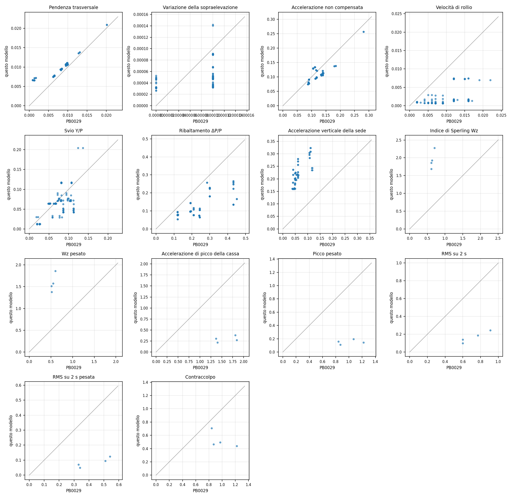

# Transito dinamico dei treni

Analisi al passo del transito dei treni reali RFI 1-6 sul modello globale, con la matrice di analisi e i criteri della relazione di percorribilità, sicurezza e comfort del progetto definitivo (PB0029), combinazione SLS1 2: pesi propri, traffico stradale QR, un treno dinamico per binario, con e senza termica.

## Modello

* **Ponte**: modello globale nello stato di riferimento, cavi linearizzati sotto i permanenti. Il treno corre sul binario indeformato dai permanenti (PB0029 par. 4.1.1).
* **Integrazione**: HHT-alfa (alfa = -0,05) sul sistema completo, senza troncamento modale (il progetto usa 500 autostati), passo 0,01 s. L'accoppiamento ponte-veicoli e la legge della rotaia sono risolti a ogni passo per iterazione.
* **Smorzamento**: Rayleigh con il 2 % a 0,1 Hz e a 3 Hz (PG0025 par. 6.3.3).
* **Veicoli**: 7 gradi di libertà per carrello (abbassamento, spostamento trasversale e rollio della mezza cassa; abbassamento, spostamento trasversale, beccheggio e rollio del carrello), sale a contatto rigido con il binario, molle e smorzatori lineari: lo schema del modello globale del progetto (PB0029 par. 5.1, 7.3.1). Parametri, composizione e lunghezza dei treni della tabella delle proprietà dei treni della PB0029; le lunghezze delle casse sono quelle dell'Allegato 2 (con queste i treni hanno le lunghezze della relazione: 353, 386, 591, 200, 744, 735 m).
* **Rotaie**: 2 UIC 60 per binario, binari a ±2,0 m dall'asse del cassone ferroviario, piano del ferro 1.0 m sopra il suo baricentro. In longitudinale legge elastica-perfettamente plastica di EN 1991-2 par. 6.5.4.4 e del Manuale RFI per binario senza ballast (scorrimento elastico 0,5 mm, 40 kN/m a binario scarico, 60 kN/m a binario carico). In verticale e in trasversale l'elastomero della rotaia annegata ha la rigidezza che dà 2 mm sotto 20 t/asse e sotto 20 kN laterali (PB0029 par. 1.6.1): 48.4 kN/mm e 10.5 kN/mm per metro di binario.
* **Combinazione 2**: QR statico sulla carreggiata che dà il valore più alto (3,75 kN/m sulla corsia più caricata, 1,25 kN/m sulla corsia vicina, frenatura 1/10), sovrapposto alla risposta dinamica nelle grandezze geometriche del binario; termica come variazione uniforme di +21 °C e -20,5 °C sui 20 °C di riferimento (estremi dell'aria per lo SLS, PG0024 tab. 19): ipotesi semplificata, il progetto usa casi termici del modello globale che non sono pubblicati, e nella PB0029 la termica cambia i criteri di pochi millesimi.
* **Treni**: binario 1 (Ovest) verso s crescente; con due treni il secondo corre sul binario 2 in verso opposto e le teste si incontrano in mezzeria, alla torre S+ (s = 1650 m) o al giunto S+ (testata).
* **Grandezze**: misurate sotto il treno, come nel modello del progetto. Pendenza trasversale = rollio delle sale; variazione della sopraelevazione = differenza del rollio delle due sale del carrello per 1,5 m, divisa per il passo; accelerazione non compensata = g x pendenza + accelerazione trasversale della cassa; accelerazione della sede = accelerazione verticale del punto del ponte sotto le ruote, fuori dai 100 m presso i giunti di espansione delle testate (come la PB0029, il cui modello fa correre il treno sull'impalcato e non sul binario, continuo sul giunto); il valore con i giunti è riportato nella sezione Rotaie e sede; svio Y/P = forza trasversale della sala sulla ruota meno carica; ribaltamento = massimo alleggerimento relativo della ruota. Comfort a 120 km/h sull'accelerazione verticale della cassa: indice di Sperling con e senza pesatura, picco, RMS su 2 s e contraccolpo come variazione della RMS mobile.

## Sintesi

Massimi su tutti i casi, nostri e della relazione (combinazione 2, con e senza termica).

| Criterio | Limite SLS1 | Questo modello | PB0029 | Rapporto medio |
|---|---|---|---|---|
| Pendenza trasversale [m/m] | 0.08 | 0.0209 | 0.0201 | 1.62 |
| Variazione della sopraelevazione [m/m] | 0.0025 | 0.0001 | 0.0001 | 0.54 |
| Accelerazione non compensata [m/s²] | 0.6 | 0.2571 | 0.2810 | 0.88 |
| Velocità di rollio [rad/s] | 0.033 | 0.0074 | 0.0220 | 0.22 |
| Svio Y/P [-] | 0.8 | 0.2047 | 0.1360 | 0.88 |
| Ribaltamento ΔP/P [-] | 0.9 | 0.2653 | 0.4500 | 0.55 |
| Accelerazione verticale della sede [m/s²] | 0.7 | 0.3239 | 0.1180 | 3.74 |
| Indice di Sperling Wz [-] | 2.2 | 2.278 | 0.700 | 3.03 |
| Wz pesato [-] | 2.2 | 1.860 | 0.600 | 2.89 |
| Accelerazione di picco della cassa [m/s²] | 2.0 | 0.381 | 1.840 | 0.18 |
| Picco pesato [m/s²] | 2.0 | 0.194 | 1.220 | 0.15 |
| RMS su 2 s [m/s²] | 0.75 | 0.243 | 0.910 | 0.23 |
| RMS su 2 s pesata [m/s²] | 0.75 | 0.124 | 0.540 | 0.19 |
| Contraccolpo [m/s³] | 0.25 | 0.708 | 1.220 | 0.56 |

*Figura 1 — Criteri di percorribilità, sicurezza e comfort, questo modello contro la relazione di percorribilità per tutti i casi della combinazione 2 (la retta è l'uguaglianza)*

## Percorribilità e sicurezza, 144 km/h

Per ogni caso e binario: questo modello / PB0029.

| Caso | Treni | Incontro | Binario | RFI | Termica | Pendenza trasversale [m/m] | Variazione della sopraelevazione [m/m] | Accelerazione non compensata [m/s²] | Velocità di rollio [rad/s] | Svio Y/P [-] | Ribaltamento ΔP/P [-] | Accelerazione verticale della sede [m/s²] |
|---|---|---|---|---|---|---|---|---|---|---|---|---|
| 1 | 1 | - | 1 | 1 | no | 0.0107 / 0.0095 | 0.0000 / 0.0000 | 0.1084 / 0.1340 | 0.0007 / 0.0060 | 0.0710 / 0.1050 | 0.0964 / 0.1920 | 0.1599 / 0.0400 |
| 1 | 1 | - | 1 | 1 | sì | 0.0108 / 0.0095 | 0.0000 / 0.0001 | 0.1086 / 0.1340 | 0.0007 / 0.0050 | 0.0710 / 0.0810 | 0.0964 / 0.1920 | 0.1599 / 0.0400 |
| 2 | 2 | - | 1 | 2 | no | 0.0110 / 0.0098 | 0.0000 / 0.0001 | 0.1109 / 0.1380 | 0.0007 / 0.0090 | 0.0640 / 0.0680 | 0.0772 / 0.1190 | 0.1611 / 0.0380 |
| 2 | 2 | - | 1 | 2 | sì | 0.0111 / 0.0098 | 0.0000 / 0.0001 | 0.1110 / 0.1380 | 0.0007 / 0.0070 | 0.0640 / 0.0530 | 0.0772 / 0.1190 | 0.1611 / 0.0380 |
| 3 | 3 | - | 1 | 3 | no | 0.0111 / 0.0099 | 0.0001 / 0.0001 | 0.1148 / 0.1390 | 0.0013 / 0.0170 | 0.0766 / 0.1000 | 0.0738 / 0.2410 | 0.1955 / 0.0500 |
| 3 | 3 | - | 1 | 3 | sì | 0.0111 / 0.0099 | 0.0001 / 0.0001 | 0.1149 / 0.1390 | 0.0013 / 0.0120 | 0.0766 / 0.0750 | 0.0738 / 0.2410 | 0.1955 / 0.0500 |
| 4 | 4 | - | 1 | 4 | no | 0.0107 / 0.0094 | 0.0001 / 0.0000 | 0.1073 / 0.1320 | 0.0009 / 0.0030 | 0.0299 / 0.0220 | 0.0979 / 0.1950 | 0.2270 / 0.0600 |
| 4 | 4 | - | 1 | 4 | sì | 0.0107 / 0.0094 | 0.0001 / 0.0001 | 0.1075 / 0.1320 | 0.0009 / 0.0020 | 0.0299 / 0.0180 | 0.0979 / 0.1950 | 0.2270 / 0.0600 |
| 5 | 5 | - | 1 | 5 | no | 0.0209 / 0.0201 | 0.0001 / 0.0001 | 0.2570 / 0.2810 | 0.0070 / 0.0190 | 0.2047 / 0.1240 | 0.2565 / 0.2840 | 0.3091 / 0.1100 |
| 5 | 5 | - | 1 | 5 | sì | 0.0209 / 0.0201 | 0.0001 / 0.0001 | 0.2571 / 0.2810 | 0.0070 / 0.0220 | 0.2047 / 0.1360 | 0.2565 / 0.2840 | 0.3091 / 0.1110 |
| 6 | 6 | - | 1 | 6 | no | 0.0110 / 0.0099 | 0.0000 / 0.0001 | 0.1209 / 0.1380 | 0.0016 / 0.0160 | 0.0717 / 0.0970 | 0.1664 / 0.4500 | 0.1848 / 0.0410 |
| 6 | 6 | - | 1 | 6 | sì | 0.0110 / 0.0099 | 0.0000 / 0.0001 | 0.1211 / 0.1390 | 0.0016 / 0.0120 | 0.0717 / 0.0740 | 0.1664 / 0.4500 | 0.1848 / 0.0400 |
| 10 | 1+4 | giunto S+ | 1 | 1 | no | 0.0107 / 0.0095 | 0.0000 / 0.0001 | 0.1084 / 0.1340 | 0.0007 / 0.0060 | 0.0710 / 0.1050 | 0.0964 / 0.1920 | 0.2567 / 0.0600 |
| 10 | 1+4 | giunto S+ | 2 | 4 | no | 0.0077 / 0.0065 | 0.0000 / 0.0001 | 0.0774 / 0.0910 | 0.0009 / 0.0020 | 0.0115 / 0.0260 | 0.1083 / 0.2090 | 0.2779 / n.d. |
| 10 | 1+4 | giunto S+ | 1 | 1 | sì | 0.0108 / 0.0095 | 0.0000 / 0.0001 | 0.1086 / 0.1340 | 0.0007 / 0.0050 | 0.0710 / 0.0800 | 0.0964 / 0.1920 | 0.2567 / 0.0600 |
| 10 | 1+4 | giunto S+ | 2 | 4 | sì | 0.0077 / 0.0065 | 0.0000 / 0.0001 | 0.0776 / 0.0910 | 0.0009 / 0.0020 | 0.0115 / 0.0200 | 0.1083 / 0.2090 | 0.2779 / n.d. |
| 10 | 1+4 | mezzeria | 1 | 1 | no | 0.0103 / 0.0095 | 0.0000 / 0.0000 | 0.1048 / 0.1340 | 0.0008 / 0.0060 | 0.0734 / 0.1060 | 0.0967 / 0.1920 | 0.2794 / 0.0600 |
| 10 | 1+4 | mezzeria | 2 | 4 | no | 0.0093 / 0.0081 | 0.0000 / 0.0000 | 0.0941 / 0.1130 | 0.0010 / 0.0020 | 0.0124 / 0.0270 | 0.0771 / 0.2090 | 0.2756 / n.d. |
| 10 | 1+4 | mezzeria | 1 | 1 | sì | 0.0103 / 0.0095 | 0.0000 / 0.0001 | 0.1050 / 0.1340 | 0.0008 / 0.0050 | 0.0734 / 0.0810 | 0.0967 / 0.1920 | 0.2794 / 0.0600 |
| 10 | 1+4 | mezzeria | 2 | 4 | sì | 0.0093 / 0.0081 | 0.0000 / 0.0000 | 0.0942 / 0.1130 | 0.0010 / 0.0020 | 0.0124 / 0.0200 | 0.0771 / 0.2090 | 0.2756 / n.d. |
| 10 | 1+4 | torre S+ | 1 | 1 | no | 0.0107 / 0.0095 | 0.0000 / 0.0000 | 0.1084 / 0.1340 | 0.0008 / 0.0060 | 0.0710 / 0.1050 | 0.0964 / 0.1920 | 0.2048 / 0.0600 |
| 10 | 1+4 | torre S+ | 2 | 4 | no | 0.0077 / 0.0065 | 0.0000 / 0.0001 | 0.0774 / 0.0910 | 0.0010 / 0.0020 | 0.0124 / 0.0260 | 0.0763 / 0.2090 | 0.2341 / n.d. |
| 10 | 1+4 | torre S+ | 1 | 1 | sì | 0.0108 / 0.0095 | 0.0000 / 0.0001 | 0.1086 / 0.1340 | 0.0008 / 0.0050 | 0.0710 / 0.0800 | 0.0964 / 0.1920 | 0.2048 / 0.0600 |
| 10 | 1+4 | torre S+ | 2 | 4 | sì | 0.0077 / 0.0065 | 0.0000 / 0.0001 | 0.0776 / 0.0910 | 0.0010 / 0.0020 | 0.0124 / 0.0200 | 0.0763 / 0.2090 | 0.2341 / n.d. |
| 11 | 1+5 | giunto S+ | 1 | 1 | no | 0.0107 / 0.0095 | 0.0000 / 0.0001 | 0.1084 / 0.1340 | 0.0013 / 0.0060 | 0.0903 / 0.0940 | 0.1429 / 0.1920 | 0.2348 / 0.1160 |
| 11 | 1+5 | giunto S+ | 2 | 5 | no | 0.0066 / 0.0009 | 0.0001 / 0.0001 | 0.1301 / 0.1050 | 0.0073 / 0.0150 | 0.1168 / 0.1070 | 0.2227 / 0.2990 | 0.3174 / n.d. |
| 11 | 1+5 | giunto S+ | 1 | 1 | sì | 0.0108 / 0.0095 | 0.0000 / 0.0001 | 0.1086 / 0.1340 | 0.0013 / 0.0040 | 0.0903 / 0.0720 | 0.1429 / 0.1920 | 0.2348 / 0.1180 |
| 11 | 1+5 | giunto S+ | 2 | 5 | sì | 0.0066 / 0.0009 | 0.0001 / 0.0001 | 0.1302 / 0.1050 | 0.0073 / 0.0120 | 0.1168 / 0.0810 | 0.2227 / 0.3000 | 0.3174 / n.d. |
| 11 | 1+5 | mezzeria | 1 | 1 | no | 0.0136 / 0.0128 | 0.0001 / 0.0001 | 0.1371 / 0.1790 | 0.0029 / 0.0060 | 0.0849 / 0.1060 | 0.0962 / 0.1910 | 0.2965 / 0.1070 |
| 11 | 1+5 | mezzeria | 2 | 5 | no | 0.0071 / 0.0013 | 0.0001 / 0.0001 | 0.1337 / 0.1110 | 0.0074 / 0.0160 | 0.1163 / 0.1070 | 0.1816 / 0.2990 | 0.3331 / n.d. |
| 11 | 1+5 | mezzeria | 1 | 1 | sì | 0.0136 / 0.0128 | 0.0001 / 0.0001 | 0.1372 / 0.1790 | 0.0029 / 0.0050 | 0.0849 / 0.0820 | 0.0962 / 0.1910 | 0.2965 / 0.1070 |
| 11 | 1+5 | mezzeria | 2 | 5 | sì | 0.0071 / 0.0013 | 0.0001 / 0.0001 | 0.1338 / 0.1110 | 0.0074 / 0.0120 | 0.1163 / 0.0820 | 0.1816 / 0.3000 | 0.3331 / n.d. |
| 11 | 1+5 | torre S+ | 1 | 1 | no | 0.0107 / 0.0095 | 0.0001 / 0.0000 | 0.1084 / 0.1340 | 0.0017 / 0.0060 | 0.0864 / 0.0940 | 0.1452 / 0.1920 | 0.3239 / 0.1100 |
| 11 | 1+5 | torre S+ | 2 | 5 | no | 0.0066 / 0.0012 | 0.0001 / 0.0001 | 0.1298 / 0.1050 | 0.0073 / 0.0150 | 0.1158 / 0.1070 | 0.2278 / 0.2990 | 0.3215 / n.d. |
| 11 | 1+5 | torre S+ | 1 | 1 | sì | 0.0108 / 0.0095 | 0.0001 / 0.0001 | 0.1086 / 0.1340 | 0.0017 / 0.0040 | 0.0864 / 0.0720 | 0.1452 / 0.1920 | 0.3239 / 0.1110 |
| 11 | 1+5 | torre S+ | 2 | 5 | sì | 0.0066 / 0.0012 | 0.0001 / 0.0001 | 0.1298 / 0.1050 | 0.0073 / 0.0120 | 0.1158 / 0.0810 | 0.2278 / 0.3000 | 0.3215 / n.d. |
| 12 | 1+6 | giunto S+ | 1 | 1 | no | 0.0107 / 0.0095 | 0.0000 / 0.0001 | 0.1084 / 0.1340 | 0.0007 / 0.0060 | 0.0710 / 0.1030 | 0.0964 / 0.1920 | 0.1599 / 0.0450 |
| 12 | 1+6 | giunto S+ | 2 | 6 | no | 0.0078 / 0.0065 | 0.0000 / 0.0000 | 0.0909 / 0.0910 | 0.0013 / 0.0160 | 0.0624 / 0.1130 | 0.2572 / 0.4320 | 0.2006 / n.d. |
| 12 | 1+6 | giunto S+ | 1 | 1 | sì | 0.0108 / 0.0095 | 0.0000 / 0.0001 | 0.1086 / 0.1340 | 0.0007 / 0.0040 | 0.0710 / 0.0720 | 0.0964 / 0.1920 | 0.1599 / 0.0450 |
| 12 | 1+6 | giunto S+ | 2 | 6 | sì | 0.0078 / 0.0065 | 0.0000 / 0.0001 | 0.0911 / 0.0910 | 0.0013 / 0.0120 | 0.0624 / 0.0860 | 0.2572 / 0.4320 | 0.2006 / n.d. |
| 12 | 1+6 | mezzeria | 1 | 1 | no | 0.0105 / 0.0095 | 0.0000 / 0.0000 | 0.1063 / 0.1340 | 0.0009 / 0.0060 | 0.0732 / 0.1040 | 0.0965 / 0.1910 | 0.2163 / 0.0410 |
| 12 | 1+6 | mezzeria | 2 | 6 | no | 0.0092 / 0.0082 | 0.0000 / 0.0000 | 0.1239 / 0.1150 | 0.0018 / 0.0160 | 0.0420 / 0.1130 | 0.1350 / 0.4320 | 0.2260 / n.d. |
| 12 | 1+6 | mezzeria | 1 | 1 | sì | 0.0105 / 0.0095 | 0.0000 / 0.0001 | 0.1064 / 0.1340 | 0.0009 / 0.0050 | 0.0732 / 0.0800 | 0.0965 / 0.1910 | 0.2163 / 0.0410 |
| 12 | 1+6 | mezzeria | 2 | 6 | sì | 0.0093 / 0.0082 | 0.0000 / 0.0000 | 0.1241 / 0.1150 | 0.0018 / 0.0120 | 0.0420 / 0.0870 | 0.1350 / 0.4320 | 0.2260 / n.d. |
| 12 | 1+6 | torre S+ | 1 | 1 | no | 0.0107 / 0.0095 | 0.0000 / 0.0000 | 0.1084 / 0.1340 | 0.0007 / 0.0060 | 0.0710 / 0.1030 | 0.0964 / 0.1920 | 0.2023 / 0.0500 |
| 12 | 1+6 | torre S+ | 2 | 6 | no | 0.0078 / 0.0065 | 0.0000 / 0.0000 | 0.0909 / 0.0910 | 0.0016 / 0.0160 | 0.0419 / 0.1130 | 0.2233 / 0.4320 | 0.1982 / n.d. |
| 12 | 1+6 | torre S+ | 1 | 1 | sì | 0.0108 / 0.0095 | 0.0000 / 0.0001 | 0.1086 / 0.1340 | 0.0007 / 0.0040 | 0.0710 / 0.0720 | 0.0964 / 0.1920 | 0.2023 / 0.0500 |
| 12 | 1+6 | torre S+ | 2 | 6 | sì | 0.0078 / 0.0065 | 0.0000 / 0.0001 | 0.0910 / 0.0910 | 0.0016 / 0.0120 | 0.0419 / 0.0860 | 0.2233 / 0.4320 | 0.1982 / n.d. |
| 13 | 2+2 | giunto S+ | 1 | 2 | no | 0.0110 / 0.0098 | 0.0000 / 0.0001 | 0.1109 / 0.1380 | 0.0007 / 0.0090 | 0.0640 / 0.0670 | 0.0772 / 0.1200 | 0.1611 / 0.0490 |
| 13 | 2+2 | giunto S+ | 2 | 2 | no | 0.0075 / 0.0062 | 0.0000 / 0.0001 | 0.0745 / 0.0870 | 0.0007 / 0.0090 | 0.0333 / 0.0770 | 0.0780 / 0.1220 | 0.1591 / n.d. |
| 13 | 2+2 | giunto S+ | 1 | 2 | sì | 0.0111 / 0.0098 | 0.0000 / 0.0001 | 0.1110 / 0.1380 | 0.0007 / 0.0070 | 0.0640 / 0.0510 | 0.0772 / 0.1210 | 0.1611 / 0.0490 |
| 13 | 2+2 | giunto S+ | 2 | 2 | sì | 0.0075 / 0.0062 | 0.0000 / 0.0001 | 0.0746 / 0.0870 | 0.0007 / 0.0070 | 0.0333 / 0.0590 | 0.0780 / 0.1200 | 0.1591 / n.d. |
| 13 | 2+2 | mezzeria | 1 | 2 | no | 0.0106 / 0.0099 | 0.0000 / 0.0001 | 0.1061 / 0.1390 | 0.0007 / 0.0090 | 0.0641 / 0.0670 | 0.0772 / 0.1200 | 0.2005 / 0.0480 |
| 13 | 2+2 | mezzeria | 2 | 2 | no | 0.0094 / 0.0081 | 0.0000 / 0.0000 | 0.0941 / 0.1140 | 0.0007 / 0.0090 | 0.0296 / 0.0830 | 0.0543 / 0.1210 | 0.2164 / n.d. |
| 13 | 2+2 | mezzeria | 1 | 2 | sì | 0.0106 / 0.0099 | 0.0000 / 0.0001 | 0.1062 / 0.1390 | 0.0007 / 0.0070 | 0.0641 / 0.0510 | 0.0772 / 0.1210 | 0.2005 / 0.0480 |
| 13 | 2+2 | mezzeria | 2 | 2 | sì | 0.0094 / 0.0081 | 0.0000 / 0.0000 | 0.0943 / 0.1140 | 0.0007 / 0.0070 | 0.0296 / 0.0590 | 0.0543 / 0.1200 | 0.2164 / n.d. |
| 13 | 2+2 | torre S+ | 1 | 2 | no | 0.0110 / 0.0098 | 0.0000 / 0.0001 | 0.1109 / 0.1380 | 0.0007 / 0.0090 | 0.0640 / 0.0670 | 0.0772 / 0.1200 | 0.1821 / 0.0490 |
| 13 | 2+2 | torre S+ | 2 | 2 | no | 0.0075 / 0.0062 | 0.0000 / 0.0001 | 0.0744 / 0.0870 | 0.0007 / 0.0090 | 0.0290 / 0.0770 | 0.0789 / 0.1220 | 0.1733 / n.d. |
| 13 | 2+2 | torre S+ | 1 | 2 | sì | 0.0111 / 0.0098 | 0.0000 / 0.0001 | 0.1110 / 0.1380 | 0.0007 / 0.0070 | 0.0640 / 0.0510 | 0.0772 / 0.1210 | 0.1821 / 0.0490 |
| 13 | 2+2 | torre S+ | 2 | 2 | sì | 0.0075 / 0.0062 | 0.0000 / 0.0001 | 0.0745 / 0.0870 | 0.0007 / 0.0070 | 0.0290 / 0.0590 | 0.0789 / 0.1200 | 0.1733 / n.d. |
| 14 | 2+3 | giunto S+ | 1 | 2 | no | 0.0110 / 0.0098 | 0.0000 / 0.0001 | 0.1109 / 0.1380 | 0.0007 / 0.0090 | 0.0640 / 0.0660 | 0.0772 / 0.1200 | 0.1769 / 0.0480 |
| 14 | 2+3 | giunto S+ | 2 | 3 | no | 0.0076 / 0.0063 | 0.0000 / 0.0001 | 0.0811 / 0.0890 | 0.0013 / 0.0160 | 0.0515 / 0.1120 | 0.1135 / 0.2440 | 0.2107 / n.d. |
| 14 | 2+3 | giunto S+ | 1 | 2 | sì | 0.0111 / 0.0098 | 0.0000 / 0.0001 | 0.1110 / 0.1380 | 0.0007 / 0.0070 | 0.0640 / 0.0510 | 0.0772 / 0.1210 | 0.1769 / 0.0490 |
| 14 | 2+3 | giunto S+ | 2 | 3 | sì | 0.0076 / 0.0064 | 0.0000 / 0.0001 | 0.0813 / 0.0890 | 0.0013 / 0.0120 | 0.0515 / 0.0860 | 0.1135 / 0.2440 | 0.2107 / n.d. |
| 14 | 2+3 | mezzeria | 1 | 2 | no | 0.0107 / 0.0099 | 0.0000 / 0.0001 | 0.1073 / 0.1390 | 0.0008 / 0.0090 | 0.0641 / 0.0670 | 0.0772 / 0.1200 | 0.2249 / 0.0510 |
| 14 | 2+3 | mezzeria | 2 | 3 | no | 0.0095 / 0.0083 | 0.0000 / 0.0000 | 0.0995 / 0.1170 | 0.0016 / 0.0160 | 0.0466 / 0.1120 | 0.0641 / 0.2440 | 0.2377 / n.d. |
| 14 | 2+3 | mezzeria | 1 | 2 | sì | 0.0107 / 0.0099 | 0.0000 / 0.0001 | 0.1074 / 0.1390 | 0.0008 / 0.0070 | 0.0641 / 0.0500 | 0.0772 / 0.1210 | 0.2249 / 0.0510 |
| 14 | 2+3 | mezzeria | 2 | 3 | sì | 0.0095 / 0.0083 | 0.0000 / 0.0000 | 0.0996 / 0.1170 | 0.0016 / 0.0120 | 0.0466 / 0.0860 | 0.0641 / 0.2440 | 0.2377 / n.d. |
| 14 | 2+3 | torre S+ | 1 | 2 | no | 0.0110 / 0.0098 | 0.0000 / 0.0001 | 0.1109 / 0.1380 | 0.0007 / 0.0090 | 0.0640 / 0.0660 | 0.0772 / 0.1200 | 0.2219 / 0.0490 |
| 14 | 2+3 | torre S+ | 2 | 3 | no | 0.0076 / 0.0064 | 0.0000 / 0.0001 | 0.0812 / 0.0890 | 0.0014 / 0.0160 | 0.0464 / 0.1120 | 0.1052 / 0.2440 | 0.2246 / n.d. |
| 14 | 2+3 | torre S+ | 1 | 2 | sì | 0.0111 / 0.0098 | 0.0000 / 0.0001 | 0.1110 / 0.1380 | 0.0007 / 0.0070 | 0.0640 / 0.0510 | 0.0772 / 0.1210 | 0.2219 / 0.0490 |
| 14 | 2+3 | torre S+ | 2 | 3 | sì | 0.0076 / 0.0064 | 0.0000 / 0.0001 | 0.0813 / 0.0890 | 0.0014 / 0.0120 | 0.0464 / 0.0860 | 0.1052 / 0.2440 | 0.2246 / n.d. |
| 15 | 2+4 | giunto S+ | 1 | 2 | no | 0.0110 / 0.0098 | 0.0000 / 0.0001 | 0.1109 / 0.1380 | 0.0007 / 0.0090 | 0.0640 / 0.0670 | 0.0772 / 0.1200 | 0.2108 / 0.0600 |
| 15 | 2+4 | giunto S+ | 2 | 4 | no | 0.0077 / 0.0065 | 0.0000 / 0.0001 | 0.0774 / 0.0910 | 0.0009 / 0.0020 | 0.0120 / 0.0260 | 0.1159 / 0.2090 | 0.2321 / n.d. |
| 15 | 2+4 | giunto S+ | 1 | 2 | sì | 0.0111 / 0.0098 | 0.0000 / 0.0001 | 0.1110 / 0.1380 | 0.0007 / 0.0070 | 0.0640 / 0.0510 | 0.0772 / 0.1210 | 0.2108 / 0.0600 |
| 15 | 2+4 | giunto S+ | 2 | 4 | sì | 0.0077 / 0.0065 | 0.0000 / 0.0001 | 0.0775 / 0.0910 | 0.0009 / 0.0020 | 0.0120 / 0.0200 | 0.1159 / 0.2090 | 0.2321 / n.d. |
| 15 | 2+4 | mezzeria | 1 | 2 | no | 0.0106 / 0.0099 | 0.0000 / 0.0001 | 0.1069 / 0.1380 | 0.0007 / 0.0090 | 0.0642 / 0.0670 | 0.0772 / 0.1200 | 0.2702 / 0.0600 |
| 15 | 2+4 | mezzeria | 2 | 4 | no | 0.0096 / 0.0084 | 0.0000 / 0.0000 | 0.0968 / 0.1170 | 0.0010 / 0.0020 | 0.0124 / 0.0270 | 0.0771 / 0.2090 | 0.2779 / n.d. |
| 15 | 2+4 | mezzeria | 1 | 2 | sì | 0.0107 / 0.0099 | 0.0000 / 0.0001 | 0.1071 / 0.1380 | 0.0007 / 0.0070 | 0.0642 / 0.0520 | 0.0772 / 0.1210 | 0.2702 / 0.0600 |
| 15 | 2+4 | mezzeria | 2 | 4 | sì | 0.0096 / 0.0084 | 0.0000 / 0.0000 | 0.0970 / 0.1170 | 0.0010 / 0.0020 | 0.0124 / 0.0200 | 0.0771 / 0.2090 | 0.2779 / n.d. |
| 15 | 2+4 | torre S+ | 1 | 2 | no | 0.0110 / 0.0098 | 0.0000 / 0.0001 | 0.1109 / 0.1380 | 0.0008 / 0.0090 | 0.0640 / 0.0670 | 0.0772 / 0.1200 | 0.2149 / 0.0620 |
| 15 | 2+4 | torre S+ | 2 | 4 | no | 0.0077 / 0.0065 | 0.0000 / 0.0001 | 0.0772 / 0.0910 | 0.0011 / 0.0020 | 0.0124 / 0.0260 | 0.0761 / 0.2090 | 0.2500 / n.d. |
| 15 | 2+4 | torre S+ | 1 | 2 | sì | 0.0111 / 0.0098 | 0.0000 / 0.0001 | 0.1110 / 0.1380 | 0.0008 / 0.0070 | 0.0640 / 0.0510 | 0.0772 / 0.1210 | 0.2149 / 0.0610 |
| 15 | 2+4 | torre S+ | 2 | 4 | sì | 0.0077 / 0.0065 | 0.0000 / 0.0001 | 0.0774 / 0.0910 | 0.0011 / 0.0020 | 0.0124 / 0.0200 | 0.0761 / 0.2090 | 0.2500 / n.d. |
| 16 | 2+5 | giunto S+ | 1 | 2 | no | 0.0110 / 0.0098 | 0.0000 / 0.0001 | 0.1109 / 0.1380 | 0.0011 / 0.0090 | 0.0640 / 0.0620 | 0.0937 / 0.1200 | 0.2434 / 0.1160 |
| 16 | 2+5 | giunto S+ | 2 | 5 | no | 0.0066 / 0.0009 | 0.0001 / 0.0001 | 0.1301 / 0.1050 | 0.0073 / 0.0150 | 0.1174 / 0.1070 | 0.2285 / 0.2990 | 0.3185 / n.d. |
| 16 | 2+5 | giunto S+ | 1 | 2 | sì | 0.0111 / 0.0098 | 0.0000 / 0.0001 | 0.1110 / 0.1380 | 0.0011 / 0.0070 | 0.0640 / 0.0480 | 0.0937 / 0.1200 | 0.2434 / 0.1180 |
| 16 | 2+5 | giunto S+ | 2 | 5 | sì | 0.0067 / 0.0009 | 0.0001 / 0.0001 | 0.1302 / 0.1050 | 0.0073 / 0.0120 | 0.1174 / 0.0810 | 0.2285 / 0.3000 | 0.3185 / n.d. |
| 16 | 2+5 | mezzeria | 1 | 2 | no | 0.0138 / 0.0131 | 0.0001 / 0.0001 | 0.1382 / 0.1840 | 0.0028 / 0.0090 | 0.0645 / 0.0670 | 0.0772 / 0.1190 | 0.3040 / 0.1070 |
| 16 | 2+5 | mezzeria | 2 | 5 | no | 0.0072 / 0.0017 | 0.0001 / 0.0001 | 0.1339 / 0.1120 | 0.0074 / 0.0160 | 0.1173 / 0.1070 | 0.1816 / 0.2990 | 0.3216 / n.d. |
| 16 | 2+5 | mezzeria | 1 | 2 | sì | 0.0138 / 0.0131 | 0.0001 / 0.0001 | 0.1383 / 0.1840 | 0.0028 / 0.0070 | 0.0645 / 0.0530 | 0.0772 / 0.1190 | 0.3040 / 0.1070 |
| 16 | 2+5 | mezzeria | 2 | 5 | sì | 0.0072 / 0.0017 | 0.0001 / 0.0001 | 0.1340 / 0.1120 | 0.0074 / 0.0120 | 0.1173 / 0.0820 | 0.1816 / 0.3000 | 0.3216 / n.d. |
| 16 | 2+5 | torre S+ | 1 | 2 | no | 0.0110 / 0.0098 | 0.0001 / 0.0001 | 0.1109 / 0.1380 | 0.0018 / 0.0090 | 0.0640 / 0.0620 | 0.0932 / 0.1200 | 0.2833 / 0.1080 |
| 16 | 2+5 | torre S+ | 2 | 5 | no | 0.0066 / 0.0013 | 0.0001 / 0.0001 | 0.1292 / 0.1050 | 0.0073 / 0.0150 | 0.1162 / 0.1070 | 0.2272 / 0.2990 | 0.3212 / n.d. |
| 16 | 2+5 | torre S+ | 1 | 2 | sì | 0.0111 / 0.0098 | 0.0001 / 0.0001 | 0.1110 / 0.1380 | 0.0018 / 0.0070 | 0.0640 / 0.0480 | 0.0932 / 0.1200 | 0.2833 / 0.1080 |
| 16 | 2+5 | torre S+ | 2 | 5 | sì | 0.0066 / 0.0013 | 0.0001 / 0.0001 | 0.1293 / 0.1050 | 0.0073 / 0.0120 | 0.1162 / 0.0810 | 0.2272 / 0.3000 | 0.3212 / n.d. |
| 17 | 2+6 | giunto S+ | 1 | 2 | no | 0.0110 / 0.0098 | 0.0000 / 0.0001 | 0.1109 / 0.1380 | 0.0007 / 0.0090 | 0.0640 / 0.0650 | 0.0772 / 0.1200 | 0.1627 / 0.0460 |
| 17 | 2+6 | giunto S+ | 2 | 6 | no | 0.0078 / 0.0065 | 0.0000 / 0.0001 | 0.0909 / 0.0910 | 0.0013 / 0.0160 | 0.0515 / 0.1130 | 0.2653 / 0.4320 | 0.2001 / n.d. |
| 17 | 2+6 | giunto S+ | 1 | 2 | sì | 0.0111 / 0.0098 | 0.0000 / 0.0001 | 0.1110 / 0.1380 | 0.0007 / 0.0070 | 0.0640 / 0.0500 | 0.0772 / 0.1200 | 0.1627 / 0.0460 |
| 17 | 2+6 | giunto S+ | 2 | 6 | sì | 0.0078 / 0.0065 | 0.0000 / 0.0001 | 0.0911 / 0.0910 | 0.0013 / 0.0120 | 0.0515 / 0.0860 | 0.2653 / 0.4320 | 0.2001 / n.d. |
| 17 | 2+6 | mezzeria | 1 | 2 | no | 0.0108 / 0.0098 | 0.0000 / 0.0001 | 0.1079 / 0.1380 | 0.0008 / 0.0090 | 0.0641 / 0.0670 | 0.0772 / 0.1190 | 0.2363 / 0.0410 |
| 17 | 2+6 | mezzeria | 2 | 6 | no | 0.0095 / 0.0085 | 0.0000 / 0.0000 | 0.1210 / 0.1190 | 0.0016 / 0.0160 | 0.0423 / 0.1130 | 0.1350 / 0.4320 | 0.2217 / n.d. |
| 17 | 2+6 | mezzeria | 1 | 2 | sì | 0.0108 / 0.0098 | 0.0000 / 0.0001 | 0.1080 / 0.1380 | 0.0008 / 0.0070 | 0.0641 / 0.0510 | 0.0772 / 0.1190 | 0.2363 / 0.0410 |
| 17 | 2+6 | mezzeria | 2 | 6 | sì | 0.0095 / 0.0085 | 0.0000 / 0.0000 | 0.1212 / 0.1190 | 0.0016 / 0.0120 | 0.0423 / 0.0870 | 0.1350 / 0.4320 | 0.2217 / n.d. |
| 17 | 2+6 | torre S+ | 1 | 2 | no | 0.0110 / 0.0098 | 0.0000 / 0.0001 | 0.1109 / 0.1380 | 0.0007 / 0.0090 | 0.0640 / 0.0650 | 0.0772 / 0.1200 | 0.2167 / 0.0550 |
| 17 | 2+6 | torre S+ | 2 | 6 | no | 0.0078 / 0.0065 | 0.0000 / 0.0000 | 0.0909 / 0.0910 | 0.0016 / 0.0160 | 0.0423 / 0.1130 | 0.2475 / 0.4320 | 0.2117 / n.d. |
| 17 | 2+6 | torre S+ | 1 | 2 | sì | 0.0111 / 0.0098 | 0.0000 / 0.0001 | 0.1110 / 0.1380 | 0.0007 / 0.0070 | 0.0640 / 0.0500 | 0.0772 / 0.1200 | 0.2167 / 0.0550 |
| 17 | 2+6 | torre S+ | 2 | 6 | sì | 0.0078 / 0.0065 | 0.0000 / 0.0001 | 0.0910 / 0.0910 | 0.0016 / 0.0120 | 0.0423 / 0.0860 | 0.2475 / 0.4320 | 0.2117 / n.d. |
| 18 | 3+3 | giunto S+ | 1 | 3 | no | 0.0111 / 0.0099 | 0.0001 / 0.0001 | 0.1148 / 0.1390 | 0.0013 / 0.0160 | 0.0742 / 0.0970 | 0.0738 / 0.2410 | 0.1955 / 0.0540 |
| 18 | 3+3 | giunto S+ | 2 | 3 | no | 0.0076 / 0.0063 | 0.0000 / 0.0001 | 0.0810 / 0.0890 | 0.0013 / 0.0160 | 0.0720 / 0.1120 | 0.1050 / 0.2440 | 0.2145 / n.d. |
| 18 | 3+3 | giunto S+ | 1 | 3 | sì | 0.0111 / 0.0099 | 0.0001 / 0.0001 | 0.1149 / 0.1390 | 0.0013 / 0.0120 | 0.0742 / 0.0750 | 0.0738 / 0.2410 | 0.1955 / 0.0530 |
| 18 | 3+3 | giunto S+ | 2 | 3 | sì | 0.0076 / 0.0063 | 0.0000 / 0.0001 | 0.0812 / 0.0890 | 0.0013 / 0.0120 | 0.0720 / 0.0860 | 0.1050 / 0.2440 | 0.2145 / n.d. |
| 18 | 3+3 | mezzeria | 1 | 3 | no | 0.0107 / 0.0100 | 0.0001 / 0.0001 | 0.1131 / 0.1410 | 0.0016 / 0.0160 | 0.0771 / 0.0980 | 0.0738 / 0.2410 | 0.2184 / 0.0590 |
| 18 | 3+3 | mezzeria | 2 | 3 | no | 0.0095 / 0.0084 | 0.0000 / 0.0000 | 0.0985 / 0.1180 | 0.0016 / 0.0160 | 0.0485 / 0.1130 | 0.0641 / 0.2440 | 0.2240 / n.d. |
| 18 | 3+3 | mezzeria | 1 | 3 | sì | 0.0107 / 0.0100 | 0.0001 / 0.0001 | 0.1133 / 0.1410 | 0.0016 / 0.0130 | 0.0771 / 0.0760 | 0.0738 / 0.2410 | 0.2184 / 0.0590 |
| 18 | 3+3 | mezzeria | 2 | 3 | sì | 0.0095 / 0.0084 | 0.0000 / 0.0000 | 0.0986 / 0.1180 | 0.0016 / 0.0120 | 0.0485 / 0.0870 | 0.0641 / 0.2440 | 0.2240 / n.d. |

## Comfort, 120 km/h (treni passeggeri)

| Caso | Treni | Incontro | Binario | RFI | Indice di Sperling Wz [-] | Wz pesato [-] | Accelerazione di picco della cassa [m/s²] | Picco pesato [m/s²] | RMS su 2 s [m/s²] | RMS su 2 s pesata [m/s²] | Contraccolpo [m/s³] |
|---|---|---|---|---|---|---|---|---|---|---|---|
| 1 | 1 | - | 1 | 1 | 1.856 / 0.610 | 1.515 / 0.510 | 0.305 / 1.370 | 0.160 / 0.840 | 0.138 / 0.600 | 0.071 / 0.330 | 0.708 / 0.840 |
| 2 | 2 | - | 1 | 2 | 1.686 / 0.610 | 1.377 / 0.520 | 0.217 / 1.400 | 0.112 / 0.870 | 0.098 / 0.600 | 0.050 / 0.340 | 0.463 / 0.870 |
| 3 | 3 | - | 1 | 3 | 1.926 / 0.630 | 1.573 / 0.550 | 0.270 / 1.840 | 0.143 / 1.220 | 0.186 / 0.770 | 0.096 / 0.510 | 0.439 / 1.220 |
| 4 | 4 | - | 1 | 4 | 2.278 / 0.700 | 1.860 / 0.600 | 0.381 / 1.810 | 0.194 / 1.070 | 0.243 / 0.910 | 0.124 / 0.540 | 0.493 / 0.970 |

## Rotaie e sede

Accelerazione verticale della sede compresi i tratti presso i giunti di espansione delle testate: massimo 2.53 m/s² (all'ingresso e all'uscita del treno dall'impalcato).

Tensione aggiuntiva nelle rotaie e forza nei collegamenti al passaggio dei treni (massimi su tutti i casi).

| Grandezza | Massimo |
|---|---|
| sigma traz max [MPa] | 27.54 |
| sigma compr max [MPa] | 18.94 |
| forza collegamento max [kN/m] | 57.83 |
| scorrimento plastico max [mm] | 0.05 |
| nodi in campo plastico | 1.00 |
