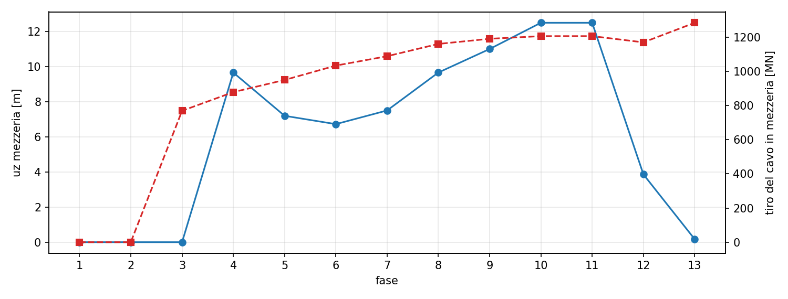
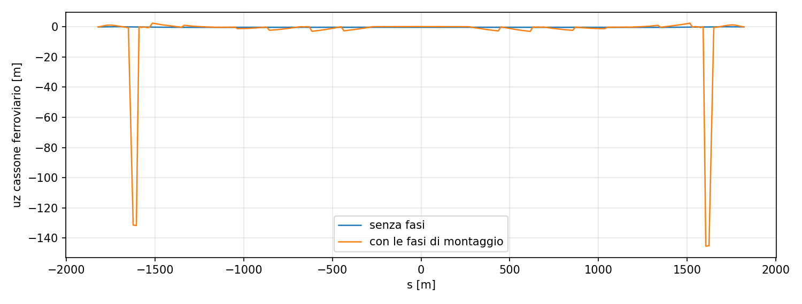
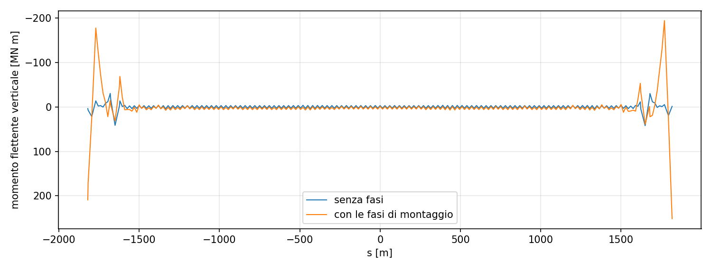

# Analisi per fasi costruttive

Analisi non lineare per fasi del montaggio, sullo stesso modello globale dell'analisi finale, confrontata con l'analisi senza fasi (tutti i pesi propri e permanenti applicati alla struttura completa, che è lo stato di riferimento usato per le azioni variabili).

## Metodo

Ogni fase è una statica non lineare: i cavi e i pendini a grandi spostamenti, con la lunghezza a riposo dello stato finale; le travi lineari a ogni fase. Una trave nasce scarica nella posizione in cui si trovano i suoi nodi e porta poi la forza accumulata più la rigidezza della fase sugli spostamenti successivi; un giunto provvisorio incernierato si chiude senza momento. I nodi nuovi seguono il nodo già montato a cui si appendono (un concio segue il pendino). Le parti che in una fase non sono ancora collegate a terra (gli elementi di collegamento fra impalcato e torri e fra impalcato e strutture terminali) nascono con l'impalcato.

## Sequenza

Dalla verifica delle fasi di montaggio del progetto definitivo (PS0263, 40 step) e dai metodi di montaggio di torri e sistema di sospensione (PS0262, PS0328):

| Fase | Descrizione | uz mezzeria [m] | Tiro del cavo in mezzeria [MN] | Iterazioni |
|---|---|---|---|---|
| 1 | Torri e strutture di terra | 0.00 | 0 | 100 |
| 2 | Arretramento delle torri (tie-back) | 0.00 | 0 | 100 |
| 3 | Cavi principali | 0.00 | 769 | 300 |
| 4 | Impalcato 13 % (|s| <= 270 m) | 9.65 | 879 | 200 |
| 5 | Impalcato 26 % (|s| <= 450 m) | 7.19 | 950 | 200 |
| 6 | Impalcato 39 % (|s| <= 690 m) | 6.72 | 1034 | 200 |
| 7 | Impalcato 52 % (|s| <= 870 m) | 7.50 | 1089 | 200 |
| 8 | Impalcato 69 % (|s| <= 1170 m) | 9.66 | 1161 | 200 |
| 9 | Impalcato 79 % (|s| <= 1350 m) | 10.99 | 1191 | 200 |
| 10 | Impalcato completo | 12.49 | 1206 | 9 |
| 11 | Chiusura dei giunti fra i conci | 12.49 | 1206 | 1 |
| 12 | Rilascio dei tiranti delle torri | 3.86 | 1170 | 8 |
| 13 | Permanenti portati | 0.17 | 1284 | 8 |

Ipotesi: le torri entrano in una sola fase con il loro peso; i cavi con tutti i trefoli (il varo trefolo per trefolo non cambia la forma, che a lunghezza a riposo assegnata dipende solo dal peso); l'impalcato si monta per conci da 60 m dalla mezzeria verso le torri alle percentuali degli step 33-38 della PS0263, con i giunti fra i conci incernierati nel piano verticale fino alla chiusura (giunti provvisori delle tavole PS0326-PS0327, cerniera all'asse del cassone); le attrezzature di montaggio, le passerelle e la regolazione dei pendini non sono modellate. La PS0263 tratta numericamente solo le torri: per cavo e impalcato il progetto non pubblica risultati per fase, quindi il confronto è fra lo stato finale con e senza fasi.

*Figura 1 — Abbassamento dell'impalcato e tiro del cavo in mezzeria fase per fase*

## Stato finale con e senza fasi

| Grandezza | Con le fasi | Senza fasi | Differenza |
|---|---|---|---|
| uz mezzeria [m] | 0.171 | -0.291 | +0.462 |
| tiro mezzeria [MN] | 1284.422 | 1292.843 | -0.7 % |
| tiro sella, campata centrale [MN] | 1382.211 | 1386.276 | -0.3 % |
| tiro sella, campata laterale [MN] | 1417.371 | 1422.246 | -0.3 % |
| tiro ancoraggio Sicilia [MN] | 1271.710 | 1345.292 | -5.5 % |
| ux sella Sicilia Est [m] | -1.094 | -1.044 | -4.8 % |
| ux sella Sicilia Ovest [m] | -1.093 | -1.045 | -4.7 % |
| ux sella Calabria Est [m] | 0.841 | 0.783 | +7.3 % |
| ux sella Calabria Ovest [m] | 0.837 | 0.782 | +7.0 % |
| pendini, tiro medio / minimo / massimo [MN] | 4.45 / 2.43 / 19.43 | 4.41 / 3.42 / 15.40 | |

*Figura 2 — Abbassamento del cassone ferroviario nello stato finale, con e senza fasi*

*Figura 3 — Momento flettente verticale del cassone ferroviario nello stato finale, con e senza fasi (momenti negativi verso l'alto)*

## Punti aperti

* Il tiro all'ancoraggio di riva Sicilia scende rispetto all'analisi senza fasi più di quanto scendono i tiri in campata: è da verificare l'equilibrio delle selle di deviazione sui pendoli dopo il rilascio dei tiranti delle torri.
* La regolazione dei pendini e delle selle prevista a fine montaggio (per riportare l'impalcato alla quota di progetto) non è nota dai documenti e non è modellata: la differenza di quota in mezzeria è la misura di quanto andrebbe regolato.

