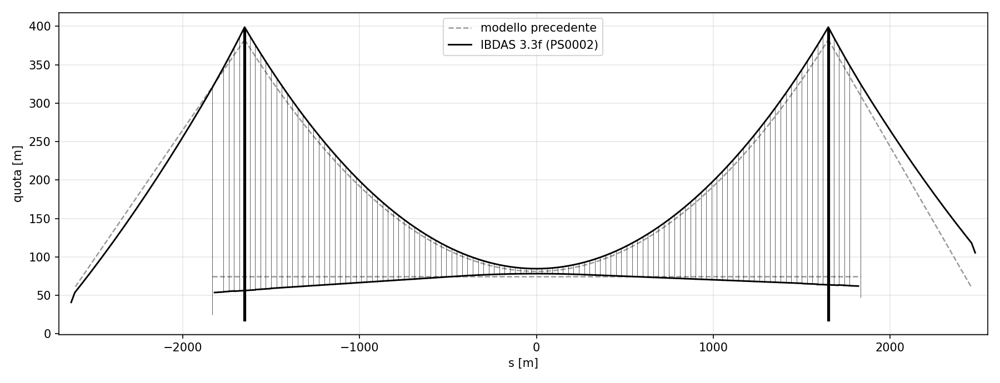

# Ponte sullo Stretto di Messina: modello globale 3D in feagent

Ricostruzione del **modello FEM globale** del Ponte sullo Stretto di Messina con
[feagent](https://github.com/DomenicoGaudioso/feagent), a partire dal modello
**IBDAS 3.3f** del Progetto Definitivo 2011 (relazione PS0002 e appendici) e dalle
**tavole quotate** dell'impalcato. Lo scopo è un modello che rispecchi quello
della documentazione, verificato numero per numero contro i risultati IBDAS.

## Il modello in breve

| Parte | Come è modellata | Fonte |
|---|---|---|
| Cavi principali | un cavo per lato nel baricentro dei due cavi gemelli (y = ±26 m), elementi cavo non lineari con lunghezza a riposo dai tiri IBDAS | PS0002 C-1, D-2, E-1, E-3 |
| Pendini | 119 per lato, ogni 30 m, cavi con lunghezza a riposo dai tiri IBDAS | PS0002 C-1, D-2, E-3 |
| Impalcato | **tre travi longitudinali**: due cassoni stradali laterali e il cassone ferroviario centrale, con sezioni diverse e a sezione variabile lungo l'asse | PS0002 D-1, tavole PS0093, PS0097, PS0100, PS0102 |
| Traversi | 117 traversi dei pendini, travi a sezione variabile (altezza da 1,5 a 4,7 m) sull'asse IBDAS, con i nodi in comune con i tre cassoni e con i pendini ed eccentricità d'estremità | PS0002 C-1, C-2, D-1, tavola PS0115 |
| Torri | gambe a sezione variabile (ottagono con pareti interne), tre traversi di torre, selle | PS0002 C-1, D-1 |
| Parti secondarie | strutture terminali, viadotti di approccio, pile, fondazioni, blocchi di ancoraggio, pendoli, collegamenti impalcato-torre, ammortizzatori | PS0002 C-1, C-2, C-3, D-1 |
| Carichi | permanenti PP e PN di PS0002 par. 3.2 (= PG0022, modello 3.3f), tarati sui tiri IBDAS | PS0002, PG0022 |
| Stato di riferimento | lunghezze a riposo di cavi e pendini dai tiri E-3, controfreccia delle torri trovata per iterazione | PS0002 E-1, E-3 |

Tutto a **elementi trave** (nessun guscio), più cavi e pendini; nessun elemento di
collegamento nell'impalcato. Asse Z verso l'alto, impalcato nel piano X-Y; nessun
vincolo sui cavi: i vincoli sono solo le fondazioni.

## Risultati principali

Vedi [Risultati e confronto con IBDAS](09-risultati.html). In sintesi: tiri dei cavi
entro l'1 % da IBDAS, tiri dei pendini entro l'1,6 % in media, modi trasversale,
longitudinale e verticale simmetrico entro l'1,3 %. I carichi mobili stradali e
ferroviari e il vento sono in [Carichi mobili e vento](14-mobili-vento.html): sotto
il carico addensato QA l'impalcato si abbassa fino a 12-14 m e i cavi prendono il
21 % in più di tiro; il vento SLU di raffica lo sposta di 12 m in mezzeria. I punti
ancora aperti sono elencati in [Punti aperti](11-punti-aperti.html).

## Come leggere questa documentazione

1. [Fonti e documenti](01-fonti.html): da dove vengono i dati e le tavole.
2. [Sistema di riferimento](02-riferimento.html): assi IBDAS e feagent, lato Ovest ed Est.
3. [Geometria](03-geometria.html): cavi, pendini, impalcato, torri.
4. [Sezioni](04-sezioni.html): cassoni stradali e ferroviario dalle tavole, torri.
5. [Traversi e collegamenti](05-traversi.html): la struttura a tre travi collegate dai traversi.
6. [Carichi permanenti](06-carichi.html): tutte le voci e la taratura sui tiri IBDAS.
7. [Vincoli e parti secondarie](07-vincoli.html).
8. [Stato di riferimento](08-stato-di-riferimento.html): ricerca della forma.
9. [Risultati e confronto con IBDAS](09-risultati.html).
10. [Carichi mobili e vento](14-mobili-vento.html): strada, ferrovia, vento statico, riscontro con i casi di validazione IBDAS.
11. [Vista estrusa in feagent](10-vista-estrusa.html): controllo del modello in 3D.
12. [Punti aperti](11-punti-aperti.html).
13. [Sezioni da disegno DXF](12-sezioni-dxf.html): lo strumento di feagent nato da questo lavoro.
14. [Riproducibilità](13-riproducibilita.html): script, file e comandi.
